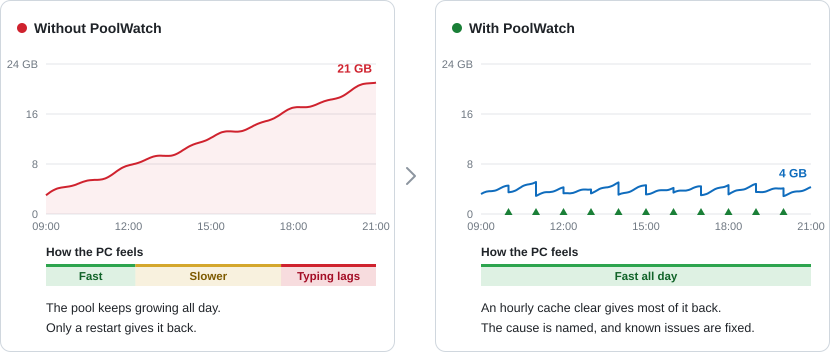

<h1 align="center">
  <picture>
    <source media="(prefers-color-scheme: dark)" srcset="docs/brand/poolwatch-wordmark-header-dark.png">
    
  </picture>
</h1>

THE MISSION

<h3 align="center">Keeps your Windows 11 PC fast and stable through long days of agentic coding.</h3>

  PoolWatch is a free Windows tray app for people who run Claude Code, Codex and other coding agents all day. It
  watches the kernel pool (memory that Windows and its drivers keep for themselves), clears what holds it, fixes known
  issues and, if you want, trims background work. Every change it makes is listed, with a way to put it back.

  <a href="https://github.com/nubbymong/poolwatch/releases/latest"><picture>
    <source media="(prefers-color-scheme: dark)" srcset="https://img.shields.io/github/v/release/nubbymong/poolwatch?style=for-the-badge&amp;label=Download&amp;labelColor=486581&amp;color=C62F37">
    
  </picture></a>
   
  Get <code>PoolWatch-v1.0.0-setup-win-x64.exe</code> from the release page (<a href="#install">install steps</a>).
   
  Free and open source · Windows 11, 64-bit · Signed · No telemetry ·
  <a href="docs/TECHNICAL.md#why-it-needs-administrator-rights">Runs as administrator</a>

  
  

  <picture>
    <source media="(prefers-color-scheme: dark)" srcset="docs/screenshots/compare-dark.svg">
    
  </picture>

  The kernel pool over one working day: an illustration with made-up numbers. On one developer PC the kernel pool
  reached about 23 GB, and even typing lagged.

## What PoolWatch does

<table>
  <tr>
    <td width="50%" valign="top">
      <picture>
        <source media="(prefers-color-scheme: dark)" srcset="docs/screenshots/pillar-watch-dark.svg">
        
      </picture>
       
      <b>Watches the kernel pool</b>
       
      Shows what is making it grow, in plain words.
    </td>
    <td width="50%" valign="top">
      <picture>
        <source media="(prefers-color-scheme: dark)" srcset="docs/screenshots/pillar-clear-dark.svg">
        
      </picture>
       
      <b>Stops the build-up</b>
       
      Empties the standby cache before the pool slows you down.
    </td>
  </tr>
  <tr>
    <td width="50%" valign="top">
      <picture>
        <source media="(prefers-color-scheme: dark)" srcset="docs/screenshots/pillar-fix-dark.svg">
        
      </picture>
       
      <b>Fixes known issues</b>
       
      The token leak, Codex's shader cache, Defender on Dev Drives.
    </td>
    <td width="50%" valign="top">
      <picture>
        <source media="(prefers-color-scheme: dark)" srcset="docs/screenshots/pillar-trim-dark.svg">
        
      </picture>
       
      <b>Trims background work</b>
       
      If you want: services, scheduled tasks and startup apps you don't need.
    </td>
  </tr>
</table>

## Why your PC slows down

Coding agents start thousands of short programs an hour and touch files all day. Windows and its drivers keep memory
for themselves to track that work: the kernel pool. On some developer PCs part of it is never handed back: a Dev
Drive's file records stay pinned by the file cache, a Windows 11 bug leaks a little with every program started, and
NTFS file records pile up while some AI desktop apps run. No app in Task Manager accounts for it, so the PC just gets
slower until you restart. PoolWatch was built after the kernel pool on one developer PC reached about 23 GB and slowed
even typing ([how PoolWatch started](docs/DESIGN.md#1-why-it-exists)).

### Is this you?

- Memory use climbs over a day or two, and no app in Task Manager accounts for it.
- Typing, the mouse or windows start to lag, although Task Manager shows spare CPU and memory.
- Only a restart makes the PC feel fast again.

To check, open Task Manager, go to **Performance** > **Memory**, and watch **Paged pool** and **Non-paged pool** while
you work. If they keep growing over hours, PoolWatch can help. If they stay flat, you do not need it.

It helps most if you:

- use a Dev Drive, or another drive formatted with ReFS (not sure? setup checks for you);
- run coding assistants such as Claude Code, Codex or Copilot, which start thousands of programs an hour;
- want evidence to send to whoever makes the program or driver that grows the pool.

## How it works

The picture at the top is an illustration. The screenshots below come from PoolWatch's own tests on a GitHub test
machine, not a developer's PC, so the programs they name are test programs: Leaker is the test tool that grows the
pool. They are taken a minute or two after PoolWatch starts, so no cache clear has run yet and the growth rate is not
known yet.

### 1. It looks at your PC and sets it up with you

At first start, **Set up PoolWatch** opens on its own, before the main window: seven short steps, about 3 minutes. It
reads your PC and shows, for each known cause of a growing kernel pool, how much it affects this PC (none, low, medium
or high) and which step fixes it. Then you choose when PoolWatch empties the standby cache (on a schedule, at a pool
size, whichever comes first, or decide later) and the fixes that fit this PC: start PoolWatch when you sign in, the
token-leak guard if this Windows build has the leak, and, if the Codex app is installed, a Codex shortcut without its
shader cache. For Microsoft Defender on a Dev Drive it shows you where the setting is; PoolWatch never changes
Defender. Setup changes no services: it shows where to trim them later, in the app. Nothing changes until you press
**Next** on the step where you chose it
([setup in the user guide](docs/USER-GUIDE.md#at-first-start-set-up-poolwatch)).

  

### 2. It watches, and says what grew

The window opens in the view you chose in setup (the **Simple view** unless you picked Advanced). The Simple view
shows the kernel pool now, which way it went in the last 10 minutes, when the next cache clear runs and what the last
one freed; four tiles (over the last 6 hours, how fast the pool grew per hour with the clears added back, what the
clears freed and the net change, and the memory in use now); the graph, with a mark at each cache clear; and **Get
more from PoolWatch**, up to three cards for what PoolWatch found on this PC and for parts of the app you may not have
found yet. It stays calm, because growth often goes away by itself, and turns red only for a real risk.

  

Switch on **Advanced view** for the details: a graph of the last hour, 6 or 24 hours with the growth and clears beside
it (and **Show RAM** for the PC's memory behind it), and **Pool causes**, which lists what grew, what the clears freed
of it, its impact, the likely cause and how sure PoolWatch is
([the Advanced view in the user guide](docs/USER-GUIDE.md#advanced-view)).

  

### 3. It recognises known issues

When what PoolWatch measures on your PC matches a known issue, it says what it is, what helps and who found it.

| Known issue | What PoolWatch can do |
|---|---|
| The Windows 11 token leak (pool tag `Toke`), documented by [bentoner](https://github.com/bentoner/windows-token-leak); how to keep the fix on after sign-in found by [gunrgbcr](https://github.com/gunrgbcr/windows-token-leak-logon-fix) | the token-leak guard |
| ReFS file records kept in the kernel pool by the file cache | the automatic cache clear |
| NTFS file records piling up while the Codex or Claude desktop app runs | nothing yet: the note says what helped others |
| NTFS file records piling up while the Codex desktop app (its program is ChatGPT.exe) opens its GPU shader cache files thousands of times a second | a desktop shortcut that starts the app without that cache: worth trying, not a sure fix ([traced and measured by Faarfarin](https://github.com/openai/codex/issues/31212#issuecomment-5635622083); [a report where it did not help](https://github.com/openai/codex/issues/56160)). PoolWatch never changes the Codex app itself |

**The token-leak guard.** On some Windows 11 24H2 and 25H2 builds, a Windows bug leaks a little of the kernel pool
every time one program starts another, and coding assistants start thousands of programs an hour. A Windows setting
stops it, but Windows resets it at each sign-in, so the guard sets it again each time PoolWatch starts. What you will
notice: another program can bring its window to the front by itself, even while you type somewhere else, and your
typing then goes into that window. Most people find that rare and easy to live with. To stop it, turn it off in Active
changes; the setting itself lasts until you sign out. A restart frees what has already leaked. When setup did not find
the leak, PoolWatch keeps watching for it, checks again after a Windows update, and offers the guard if it appears.

The known issues live in [`knowledge/`](knowledge), one file each, built into every release; PoolWatch does not
download them. A file holds only text, pool tags, program names, numbers and links: nothing PoolWatch would run. Know
another one? Add it with a pull request ([how to write a known-issue file](docs/knowledge-packs.md)), or describe it
with the [known-issue form](https://github.com/nubbymong/poolwatch/issues/new?template=known_issue.yml).

### 4. It trims background work, if you want

In the Advanced view, the **Services** tab lists the background services you may not need, with what each one costs
now and what you lose by turning it off. Windows' own services come first, each with the source PoolWatch follows
(Microsoft's virtual-desktop optimisation tool, the CIS security checklist for company PCs, or no official source);
those sources were written for virtual desktops and company PCs, so check what you lose first. For the services of
other apps there is no official source, so **Decide with your AI agent** saves a prompt for Claude Code, Codex or any
other agent: it asks how you use this PC and writes an answer, and **Import answer** shows every change before
anything is turned off. The **Tasks and startup apps** tab ranks startup apps, scheduled tasks and apps busy in the
background by what each costs now, and switches one off with the same switch as Task Manager's Startup apps or Task
Scheduler's Disable: nothing is deleted. Protected services (security, Windows Update, input and audio, Hyper-V and
WSL, core) are never changed ([services, tasks and the AI agent in the user guide](docs/USER-GUIDE.md#services)).

  

### 5. It writes reports for whoever makes the program or driver

When something keeps growing, PoolWatch writes a report with a timeline, the likely causes and the evidence for each.
The reports stay on your PC. **Export report** makes a copy to share, with your user and PC names, home paths and
anything that looks like a password or key taken out, as best it can. Read it before you post it.

## You stay in control

  

Nothing changes without your OK. Every change PoolWatch made to your PC that is still in effect is listed under
**Active changes**: the features you turned on (starting at sign-in, the automatic cache clear, the token-leak guard,
the Codex shortcut), each with **Turn off** (the shortcut: **Remove**), and what PoolWatch turned off (services,
scheduled tasks, startup apps, and a RAMMap clear task of yours it replaced), each with **Put back**, and any other
change it made (a service set to its Windows default, a task or startup app turned on), also with **Put back**.
**Put all back** does them all, after one question. A few things cannot fully come back, and the list says which: for
example, the token-leak guard's Windows setting lasts until you sign out. Programs you ended are not listed: start them
again. Uninstalling puts back everything it can by default, and says what it put back and what it could not
([Active changes in the user guide](docs/USER-GUIDE.md#active-changes)).

**Why it asks for administrator rights.** Reading the kernel pool by tag, seeing every program that starts, recording a
trace and clearing the standby cache all need them. Watching happens on its own. Every change to your PC waits for your
click or a setting you turned on, apart from creating PoolWatch's own data folder and tidying up after an older
PoolWatch (SECURITY.md lists each). It never installs a driver, runs only from inside Program Files and refuses a copy
there that you could change without administrator rights, and never writes through a file-system link (a junction or
symbolic link). [What it does with those rights](docs/TECHNICAL.md#why-it-needs-administrator-rights); how each
action is checked: [SECURITY.md](SECURITY.md), which also lists the [known limitations](SECURITY.md#known-limitations),
one of them with no defence yet in 1.0.0.

**Signed and checkable.** Every PoolWatch program, the setup and its uninstaller are signed, with a timestamp, and each
release lists the SHA-256 of the setup and both zips in `SHA256SUMS.txt`
([how to verify a release](docs/TECHNICAL.md#verify-a-release)).

## Privacy

**Nothing leaves your PC except the update check**, which is on by default and easy to turn off. Once a day,
PoolWatch asks GitHub's API whether a newer stable release of PoolWatch is out:

- It sends one request for PoolWatch's latest release on GitHub, which carries PoolWatch's own version in its
  User-Agent line ("PoolWatch/1.0.0"). No sign-in, no cookies, nothing about you or your PC. The full request is in
  [SECURITY.md](SECURITY.md#security-model).
- GitHub sees your IP address and the time, as it does for any web page.
- The first check waits until you have finished setup; its last step has the switch.
- When a newer version is out, the bottom of the window says "PoolWatch x.y.z is available. See what's new", and the
  tray menu says "PoolWatch x.y.z is available". Either opens that release's page in your browser. PoolWatch never
  downloads, installs or runs anything.
- Turn it off with **Tell me when a new version is out** on setup's last step, or under **Update notices** in Settings
  (in the Advanced view).

Your browser opens a web page only when **you** click one: Report an issue (its address holds only the title,
PoolWatch's version and Windows), the links in About and in setup's explanations, or an update notice. PoolWatch has no
telemetry, no crash upload and no symbol server.

**Your coding agents' transcripts stay on your PC.** PoolWatch reads Claude Code transcripts on this PC only, to name
the session behind a growth, and never sends them. To explain a growth it also reads every program's command line and,
for a program that runs under Claude Code, its working folder; for setup, it looks at your installed Store apps and AI
tools. It keeps what it finds in its data folder and sends none of it: Report an issue takes out session names and ids,
project folders and command lines before it shows you the preview, and the update check sends nothing about your PC.
An export you choose to share can contain session ids and project names (see below).

**The AI agent prompt is yours to give.** **Decide with your AI agent** shows every word of its prompt before you save
or copy it: the names and publishers of the services, scheduled tasks and startup apps on this PC, what each does, and
your Windows version. Never your name, user or PC name, folder paths, or anything from your files (as best it can, as
with an export). PoolWatch saves it only where you pick, or copies it, and nothing is sent until you give it to your
agent yourself.

**Redact before you share.** The reports in PoolWatch's data folder hold full command lines (which can contain
passwords or tokens), your user and PC names, paths, your account's ID (SID), and, for a program a coding agent
started, the session, project, sub-agent and the command from its transcript. They are for you, and each says "NOT
REDACTED" at the top. To share one, use **Export report** (or **Export vendor bundle** in the tray menu) and keep the
default **Yes** to redact. Redaction replaces your user and PC names, home paths, the SID and anything that looks like
a secret; it keeps session ids, project names and the commands themselves, and cannot know every secret format, so read
an export before you post it.

## Install

1. From the [latest release](https://github.com/nubbymong/poolwatch/releases/latest), download
   `PoolWatch-v1.0.0-setup-win-x64.exe`.
2. Run it, and click **Yes** when Windows asks whether to allow it to make changes
   ([why it needs administrator rights](docs/TECHNICAL.md#why-it-needs-administrator-rights)).
3. Click **Next**, then **Install**. Setup installs PoolWatch in `C:\Program Files\PoolWatch`, with .NET included, and
   adds it to the Start menu. Leave **Start PoolWatch now** ticked and click **Finish**.

**Set up PoolWatch** opens next, on its own. The first time, it cannot be skipped, and the main window waits until you
finish it; if PoolWatch stops before then, setup opens again at its next start. Its icon stays in the notification
area by the clock (if you do not see it, click the **^** arrow there): closing the window keeps it running. To stop
PoolWatch, right-click the icon and choose **Exit**. If it starts when you sign in, it starts again at your next
sign-in, until you turn off "Start PoolWatch when you sign in" in Active changes. **Run setup again...** in the tray
menu opens setup later.

To update, run the new version's setup: it asks the running PoolWatch to exit first, and keeps your settings, reports
and Active changes.

> [!NOTE]
> **Warnings for a new app.** Releases are signed, but Windows and your browser still warn about a program few people
> have downloaded yet. The warnings fade as more people install it.
>
> - Your browser may say the file "isn't commonly downloaded": choose **Keep**.
> - Windows may show **Windows protected your PC**: click **More info**, check that **Publisher** is the name in the
>   copyright line of [LICENSE](LICENSE), then click **Run anyway**.

Prefer to install by hand? Each release also has two zips: see
[the zips in the user guide](docs/USER-GUIDE.md#the-zips-install-by-hand).

**Requirements**

- Windows 11, 64-bit. The setup also installs on Windows 10 22H2, which is not tested: Dev Drives and the token leak
  exist only on Windows 11.
- Windows on Arm: PoolWatch runs through Windows' built-in x64 emulation. Its unit tests and headless checks run on
  GitHub's Windows 11 Arm machines, but it is not tested on a real Arm PC yet. Use the setup or the self-contained zip
  there.
- Optional: the Debugging Tools for Windows (part of the Windows SDK). Its `pooltag.txt` names most of Windows' pool
  tags; without it, PoolWatch looks up the tag in the drivers and in a built-in table.

**Uninstall.** Open **Settings** > **Apps** > **Installed apps**, click **...** next to **PoolWatch**, and choose
**Uninstall**. It lists what PoolWatch changed and puts back everything it can (it lists anything it cannot), unless
you choose to keep your changes. Once everything is put back, it asks whether to delete its reports, logs and
settings: the default keeps them
([uninstall details and silent options](docs/USER-GUIDE.md#uninstall)).

## Learn more

- [User guide](docs/USER-GUIDE.md): setup, the Simple and Advanced views, Settings, growth and clears, services,
  tasks and startup apps, deciding with your AI agent, service profiles, the tray icon, Active changes, Report an
  issue, the zips and uninstalling.
- [Technical details](docs/TECHNICAL.md): why it needs administrator rights, how it decides, where it stores data, the
  command line, verifying a release and building from source.
- [Design](docs/DESIGN.md) · [Security](SECURITY.md) · [Known-issue files](docs/knowledge-packs.md) ·
  [An example incident report](docs/example-incident/report.md), from CI · [Changelog](CHANGELOG.md)

## Credits

PoolWatch builds on other people's work. The About window (tray menu, **About PoolWatch**) lists the same credits,
with links; [THIRD-PARTY-NOTICES.md](THIRD-PARTY-NOTICES.md) has the licence texts.

- [bentoner/windows-token-leak](https://github.com/bentoner/windows-token-leak): documented the Windows 11 token leak,
  its cause and the setting that stops it.
- [gunrgbcr/windows-token-leak-logon-fix](https://github.com/gunrgbcr/windows-token-leak-logon-fix): found why Windows
  undoes that setting at each sign-in and how to keep it on. PoolWatch's guard is an independent re-implementation of
  that idea; no code was copied.
- [Faarfarin, openai/codex issue 31212](https://github.com/openai/codex/issues/31212#issuecomment-5635622083): traced
  the Codex desktop app's GPU shader-cache growth and measured the workaround the Codex shortcut uses.
- [Sysinternals RAMMap](https://learn.microsoft.com/sysinternals/downloads/rammap): PoolWatch recognises a clear task
  of yours that runs it. It never ships, starts or changes RAMMap.

The Services tab also says, row by row, where the advice to turn off a Windows service comes from:
[Microsoft's Windows Desktop Optimization Tool](https://github.com/The-Virtual-Desktop-Team/Windows-Desktop-Optimization-Tool)
and the CIS Microsoft Windows 11 Enterprise Benchmark. PoolWatch's list of services cites each by item and copies no
text from either. Neither says a service is safe to turn off on your own PC.

Libraries and tools PoolWatch is built with

- [TraceEvent](https://github.com/microsoft/perfview) and its native `KernelTraceControl` and `msdia140` DLLs: read
  Windows' event traces.
- [Microsoft.Diagnostics.NETCore.Client](https://github.com/dotnet/diagnostics), the
  [Microsoft.Extensions packages](https://github.com/dotnet/runtime) and
  [System.Management](https://github.com/dotnet/runtime): parts TraceEvent needs, and reading Windows Management
  Instrumentation.
- [.NET and the Windows Desktop runtime](https://github.com/dotnet/runtime): run PoolWatch; the setup and the
  self-contained zip include them.
- [Inno Setup](https://jrsoftware.org/isinfo.php): builds the setup and the uninstaller.
- [pooltag.txt](https://learn.microsoft.com/windows-hardware/drivers/debugger/), from the Debugging Tools for Windows:
  names pool tags when installed.
- [xUnit and the .NET test SDK](https://xunit.net/): run PoolWatch's tests (not part of a release).

## Contributing

Bug reports, known issues and pull requests are welcome. [CONTRIBUTING.md](CONTRIBUTING.md) has the short version;
[AGENTS.md](AGENTS.md) has the full rules for working on the code, for people and AI coding agents alike. Questions
and ideas: [Discussions](https://github.com/nubbymong/poolwatch/discussions). Security problems: privately, as
[SECURITY.md](SECURITY.md) says. What changed in each release: [CHANGELOG.md](CHANGELOG.md).

Something wrong with PoolWatch itself? **Report an issue...** in the tray menu shows you exactly the text that will go
into the issue, with your names, paths and anything that looks like a secret replaced, before your browser opens
GitHub's form ([how Report an issue works](docs/USER-GUIDE.md#report-an-issue)).

## Licence

PoolWatch is [MIT](LICENSE). A release also ships Microsoft's TraceEvent library and other Microsoft packages (each
MIT), two Microsoft native DLLs inside TraceEvent (`KernelTraceControl.dll`, `msdia140.dll`) under Microsoft's own
redistribution terms, the .NET runtime in the setup and the self-contained zip, and the setup and uninstaller made
with Inno Setup (Inno Setup License). See [THIRD-PARTY-NOTICES.md](THIRD-PARTY-NOTICES.md).
