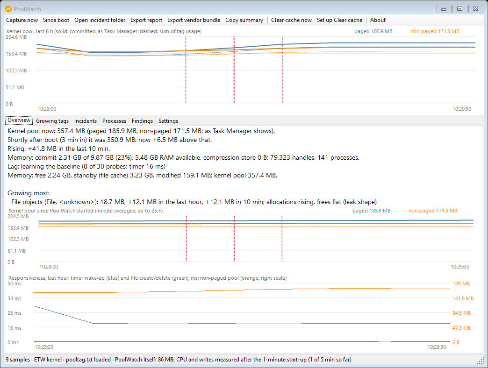
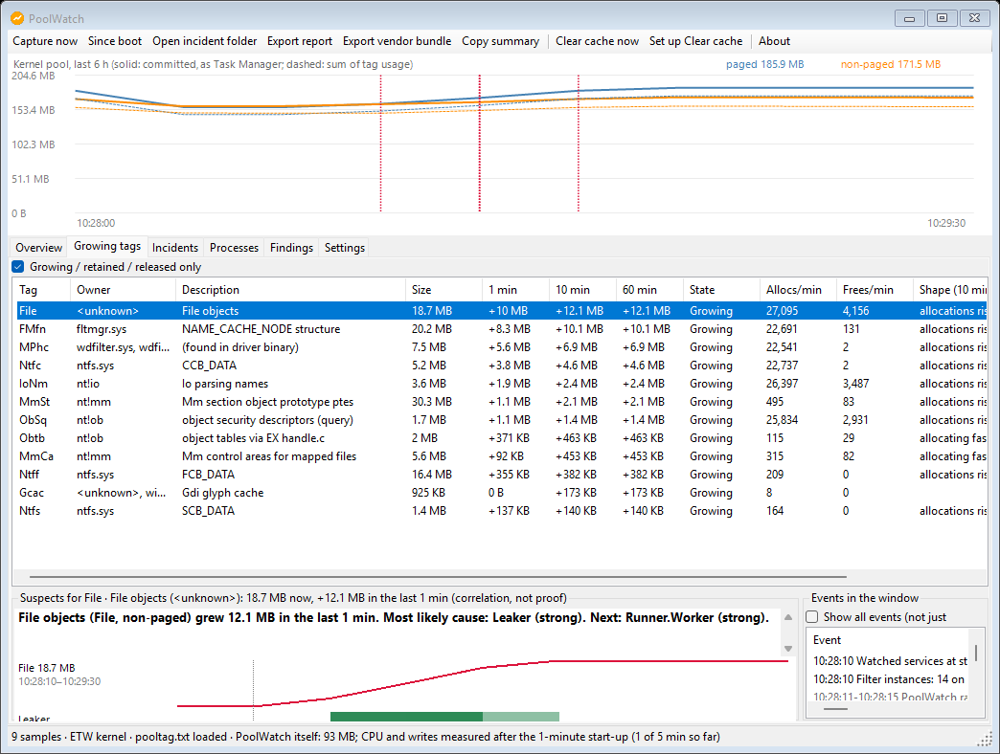
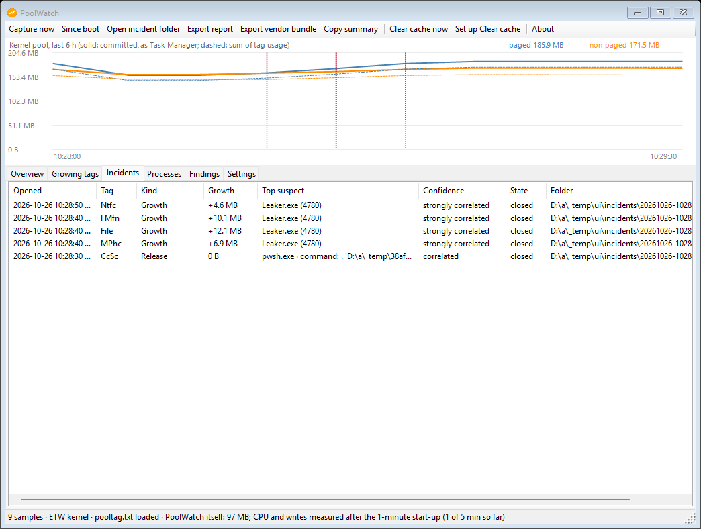
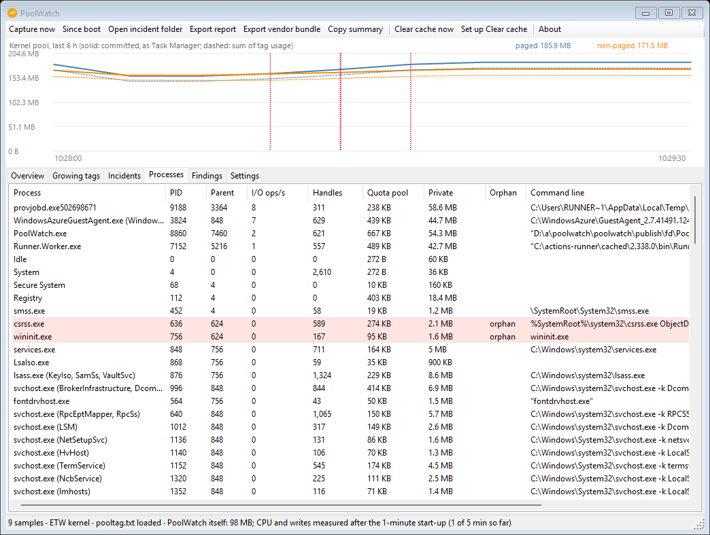
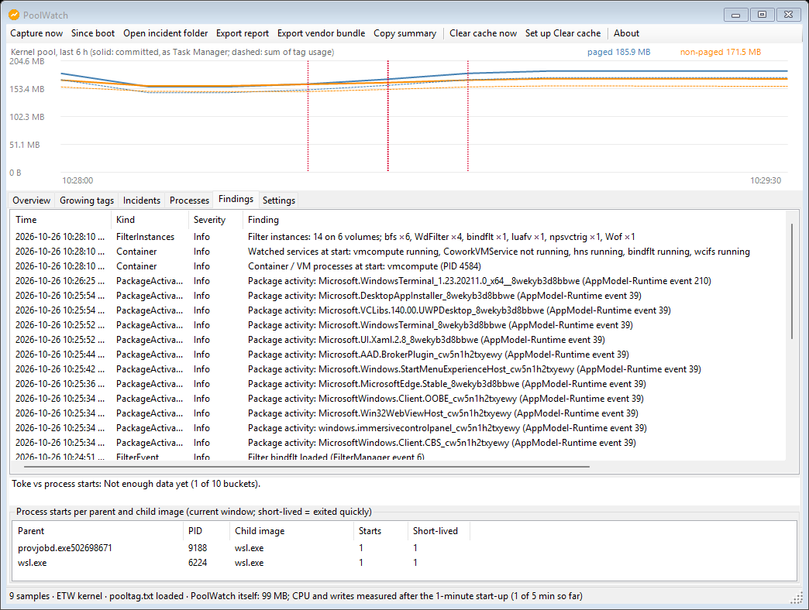

# PoolWatch

A low-overhead Windows tray app that watches the kernel **paged and non-paged pool**, works out which process,
service or driver activity is making it grow, and writes an **evidence pack** good enough for a vendor bug report.
It can also find and switch off background services that saturate the PC, and it knows about AI coding-agent
sessions (Claude Code, AI Code Conductor) when they are the ones starting the processes.



How it works is in [docs/DESIGN.md](docs/DESIGN.md). What it can change on your PC, and how to report a security
problem, is in [SECURITY.md](SECURITY.md).

## Requirements

- Windows 10 22H2 or later, or Windows 11; x64.
- Administrator rights (see [Why it runs as administrator](#why-it-runs-as-administrator)).
- For the smaller download, the [.NET 10 Desktop Runtime](https://dotnet.microsoft.com/download/dotnet/10.0) (x64). The
  self-contained download needs nothing else.
- Optional: the Debugging Tools for Windows (part of the Windows SDK), whose `pooltag.txt` gives every pool tag an owner
  and a description. Without it PoolWatch scans the drivers for the tag and uses a built-in table.

## Install

Each [release](https://github.com/nubbymong/poolwatch/releases) has two zips and a checksum file. The names carry the
release tag, for example tag `v1.0.0`:

| File (tag `v1.0.0`) | Needs | The exe inside |
|---|---|---|
| `PoolWatch-v1.0.0-win-x64.zip` | the .NET 10 Desktop Runtime (x64) | `PoolWatch.exe` |
| `PoolWatch-v1.0.0-win-x64-selfcontained.zip` | nothing (the runtime is inside) | `PoolWatch-selfcontained.exe` |
| `SHA256SUMS.txt` | the SHA-256 of each zip | |

Every PoolWatch exe in them is signed (Authenticode, timestamped) by **Nicholas Moger**, certificate thumbprint
`00EC0DEE208F91785D253C0731E28249C68053FD`. The other DLLs are Microsoft's, signed by Microsoft.

Below, use the zip you downloaded, and the exe name from the table (`PoolWatch.exe` for the framework-dependent zip,
`PoolWatch-selfcontained.exe` for the self-contained one).

1. Check the download, in PowerShell (the name is the file you downloaded):
   ```powershell
   (Get-FileHash .\PoolWatch-v1.0.0-win-x64.zip -Algorithm SHA256).Hash   # compare with SHA256SUMS.txt
   ```
2. Unpack the **whole zip** into `%ProgramFiles%\PoolWatch`, from an administrator PowerShell, and check the signature of
   the exe that zip holds:
   ```powershell
   Expand-Archive .\PoolWatch-v1.0.0-win-x64.zip -DestinationPath "$env:ProgramFiles\PoolWatch"
   (Get-AuthenticodeSignature "$env:ProgramFiles\PoolWatch\PoolWatch.exe").Status   # Valid
   # self-contained zip: check PoolWatch-selfcontained.exe instead
   ```
   Keep the `amd64` folder next to the exe: it holds the native DLLs PoolWatch loads.
3. Start the exe (`PoolWatch.exe`, or `PoolWatch-selfcontained.exe`) from there and accept the UAC prompt. A tray icon
   appears and the main window opens.
4. Optional: tick **Start at logon** (Settings). It creates a scheduled task with highest privileges, so there is no
   UAC prompt at every logon. It is only created for a copy installed under `%ProgramFiles%`.

To update, exit PoolWatch (tray menu → Exit) and replace the files. To uninstall: untick Start at logon, use **Restore
all** on the Background services page if you turned services off, exit, then delete `%ProgramFiles%\PoolWatch` and
`%ProgramData%\PoolWatch`.

## Why it runs as administrator

Pool tags, the system handle table, the kernel ETW session that sees every process start, and the WPR traces that
attribute pool allocations to a process all need administrator rights. So PoolWatch always runs elevated, and because
of that it is careful about where it runs from and what it touches:

- it refuses to run from a folder you can write to without administrator rights (Desktop, Downloads, OneDrive): another
  program could replace it there and be started as administrator;
- it writes only to its own admin-only data folder;
- it changes the system only in the ways listed below.

## What it can change, and how each change is confirmed

PoolWatch watches and reads. [SECURITY.md](SECURITY.md#what-poolwatch-changes-on-your-pc) has the full table; in short:

| Change | Confirmed by |
|---|---|
| Records a bounded WPR trace (at most 5 minutes) | **Capture now**, or the `CaptureOnAlert` setting (off by default, at most one an hour) |
| Empties the Windows standby list (the file cache) | **Clear cache now**, or the automatic clear (off by default) |
| Deletes your own RAMMap clear task (never RAMMap itself) | A Yes in a dialog that shows the task |
| Stops / disables, or restores, a background service | A dialog listing them; the original is saved; protected services are never offered |
| Disables / enables a non-Microsoft scheduled task or startup app | Your click on the selected row |
| Ends a heavy background process | A dialog with its identity, PID, start time and command line |
| Sets the live foreground lock timeout to 0 (token-leak guard) | The `TokenGuardEnabled` setting (off by default) |
| Creates or removes the Start-at-logon task; fixes an unsafe existing one | The checkbox; a question |
| Creates and locks `%ProgramData%\PoolWatch`; removes an older PoolWatch's own Clear cache tasks | Automatic, and noted on the Findings timeline |

PoolWatch never installs a driver, never uninstalls anything, and never ships or runs third-party tools.

## Using it

- **Tray icon**: green = normal, amber = a tag is growing or retained, red = an incident is open. The tooltip shows the
  committed paged / non-paged pool (the Task Manager numbers). Closing the window keeps PoolWatch running.
- **Overview**: the pool now and since boot, the top growing tags in plain words, free / standby / pool memory, the last
  cache clear, the lag probe, CPU and run queue with the page-fault split, and the token-leak guard.
- **Growing tags**: tag, owner, description, size, change over 1 / 10 / 60 minutes and state. Select a tag for its
  suspects, grouped by who they work for, with the evidence, and the process events in the window.
- **Incidents**, **Processes**, **Findings** (spawn storms, tokens, filters, lag, saturation, clears, experiments,
  versions and crashes, child accumulation, service changes, your marks), **Background services** and **Settings**.
- **Toolbar**: Capture now, Since boot (what grew since boot, hour by hour), Open incident folder, Export report, Export
  vendor bundle, Copy summary, Clear cache now.

| | |
|---|---|
|  |  |
|  |  |

The screenshots are taken on the CI runner by the UI test and predate some of the current window (it now has a
Background services tab and no Clear cache setup button); the CI `ui` job's artifacts have fresh ones.

### How it decides

Per tag it looks for **growth** (by default 200 MB in 10 minutes, 1 GB in 60 minutes, or non-paged pool over 5 GB and
still rising), **retention** (still held 15 minutes after the activity stopped) and **release** (a sharp drop: whatever
exited or was deleted then was holding the memory). Suspects are ranked on direct charge (handles of the matching type,
quota pool), activity correlation (Spearman, with a lag), lifecycle (started at onset, exited at the end, orphaned) and
ancestry. Labels are *correlated*, *strongly correlated* or *confirmed by trace*; PoolWatch never claims causation from
correlation alone.

### Background services

When the PC is saturated (all cores busy, typing lags) but pool and memory look fine, PoolWatch says so, naming the
processes by CPU and page faults. The **Background services** tab groups services into *optional* (from a catalogue,
with what you lose and the risk), *unknown* third-party ("you decide") and *protected* (never changed), shows each
one's live cost, and turns them off reversibly: the original is saved first, and **Restore** puts it back exactly.

### Token-leak guard (optional, off by default)

Some Windows 11 Insider builds leak one token reference (pool tag `Toke`) each time a process that is not allowed to take
the foreground starts a child; agent sessions start hundreds of processes a minute. With `TokenGuardEnabled` on, the
tray app tests for the leak at logon in a hidden helper and, when the build leaks, sets the **live**
`ForegroundLockTimeout` to 0 for that logon (never the registry). With 0, any app may take the focus. The workaround and
the test come from [gunrgbcr/windows-token-leak-logon-fix](https://github.com/gunrgbcr/windows-token-leak-logon-fix),
re-implemented in C#.

### AI coding-agent awareness (optional)

When a suspect runs under Claude Code, PoolWatch searches that session's transcripts (bounded) for the tool call that
started it, and names the session, project, workflow and sub-agent. Under AI Code Conductor it also labels the session
and its account profile. Nothing needs configuring: the transcripts are found from the session itself and from
`%USERPROFILE%\.claude`. `AiccResourcesRoot` can point at an AI Code Conductor resources folder to search all its
profiles.

## Where it stores data

Everything goes under `%ProgramData%\PoolWatch\` (admin-only; your account can read it), kept 7 days by default:

- `data\<yyyyMMdd>\`: `totals.csv`, `tags.csv`, `processes.csv`, `handles.csv`, `events.csv`, `services.csv`,
  `volumes.csv`, `lag.csv`, `load.csv`, `findings.jsonl` (about 2-3 MB an hour);
- `incidents\<yyyyMMdd-HHmmss>-<tag>-<hex>\`: `report.md` (headline, timeline chart, ranked suspects with evidence,
  process details, system info, a draft bug report), `report.json`, `timeline.csv`, `processes.csv`, `events.csv`,
  `timeline.png`, and `capture.etl` when a trace was taken ([an example](docs/example-incident/report.md) from CI);
- `settings.json`, `poolwatch.log`, `service-changes.json` (the original of every service PoolWatch changed),
  `boots\`, `cache\`, `exports\`, `reports\`.

## Privacy

**Nothing leaves your PC.** PoolWatch makes no network connections: no update check, no telemetry, no crash upload, no
symbol server. The only programs it starts are Windows' own `wpr.exe`, `fltmc.exe`, `schtasks.exe` and `cmd.exe` (the
token-leak test, and the self-test), `explorer.exe` to open a folder or show a file you asked for, and itself (the
hidden token-leak-test helper). Windows' programs are started by their full path under `%SystemRoot%`, and PoolWatch by
its own full path; never a bare name resolved through a shell association or the current directory.

**Redact before sharing.** The incident folders hold full command lines (which can contain passwords or tokens), your
user and machine names, paths and your SID. They are for you, and each report says "NOT REDACTED" at the top. To
share:

- use **Export report** (or **Export vendor bundle**), and keep the default **Yes** to redact: your user name, machine
  name, home and TEMP paths, domain and SID become placeholders, values that look like secrets become `<SECRET>`, and the
  `.etl` trace is left out;
- read the exported files before you post them: redaction is best-effort and cannot know every secret format;
- `RedactCopies` (on by default) applies the same redaction to rows and summaries you copy from the window.

## Command line

```
PoolWatch.exe                       tray app (opens the window)
PoolWatch.exe --tray                tray app without the window (the logon task uses this)
PoolWatch.exe --headless [--duration <s>] [--interval <s>] [--config <settings.json>] [--out <dir>] [--verbose-csv]
PoolWatch.exe --mark "<note>"       put a note on the running PoolWatch's timeline
PoolWatch.exe --services-dump <file> | --tasks-dump <file>
PoolWatch.exe --service-off <name> | --service-restore <name|all>
PoolWatch.exe --selftest --out <dir>   native collector checks against independent sources
```

Any unknown option (for example `--help`) prints the full list, run from a console.

## Build from source

You need the [.NET 10 SDK](https://dotnet.microsoft.com/download/dotnet/10.0). The code builds on any OS
(`EnableWindowsTargeting`) but runs only on Windows.

```
dotnet build PoolWatch.slnx -c Release
dotnet test tests/PoolWatch.Tests -c Release
dotnet test tests/PoolWatch.AppTests -c Release     (Windows only: the app layer, with fakes for every system change)
dotnet publish src/PoolWatch/PoolWatch.csproj -c Release -r win-x64 -p:SelfContained=false -p:PublishSingleFile=true -o publish/fd
dotnet publish src/PoolWatch/PoolWatch.csproj -c Release -r win-x64 -p:SelfContained=true -p:PublishSingleFile=true -p:EnableCompressionInSingleFile=true -o publish/sc
```

Package versions are locked (`packages.lock.json`); CI restores in locked mode. A publish folder is what gets installed.
To run a build from its output folder as administrator (CI does), add `--allow-any-location`; never use that for a
copy you keep.

The CI (`.github/workflows/ci.yml`) runs, on every pull request and push to `main`: the unit tests (also on Linux), the
native self-test, the CSV checks, end-to-end leak scenarios with `tools/Leaker`, thirteen diagnostics scenarios and the
UI smoke test. The soak and overhead checks run on demand and before every release. A tag `v*` builds, signs, verifies
and publishes the release.

## Licence

PoolWatch itself is [MIT](LICENSE). It also ships Microsoft's TraceEvent library and other Microsoft NuGet packages
(each declaring MIT), and, inside the TraceEvent package, two Microsoft native binaries (`KernelTraceControl.dll` and
`msdia140.dll`) that are Microsoft redistributables under Microsoft's own terms, not open source. The self-contained
download also bundles the Microsoft .NET runtime. See [THIRD-PARTY-NOTICES.md](THIRD-PARTY-NOTICES.md).
