# PoolWatch user guide

Everything about installing and using PoolWatch that the front page ([README](../README.md)) keeps short. The
screenshots come from PoolWatch's own tests on a GitHub test machine, a minute or two after PoolWatch starts, so no
cache clear has run in them yet and the trend and the growth rate are not known yet. The programs they name belong to
the tests or to that machine (Leaker is the test tool that grows the pool; Runner.Worker and HostedComputeAgent are
GitHub's), and update notices are off on it. The figures in the text are examples.

## At first start: Set up PoolWatch

At first start, **Set up PoolWatch** opens on its own, in a window of its own: seven short steps, about 3 minutes. The
main window waits until you finish: setup is how PoolWatch fits itself to your PC. The first time, its close button (or
Esc) asks before it closes setup; if you close it, PoolWatch keeps running in the tray and watching the kernel pool,
any change you already made with Next stays, and setup opens again when you open PoolWatch and at its next start, as
it does if PoolWatch stops before you finish. Later, **Run setup again...** in the tray menu opens it at any time, and
then closing it cancels it at once. **How PoolWatch works**, at
the bottom of every step, explains the kernel pool, why it grows with AI agents, and why emptying the standby cache is
safe.

| | |
|---|---|
| 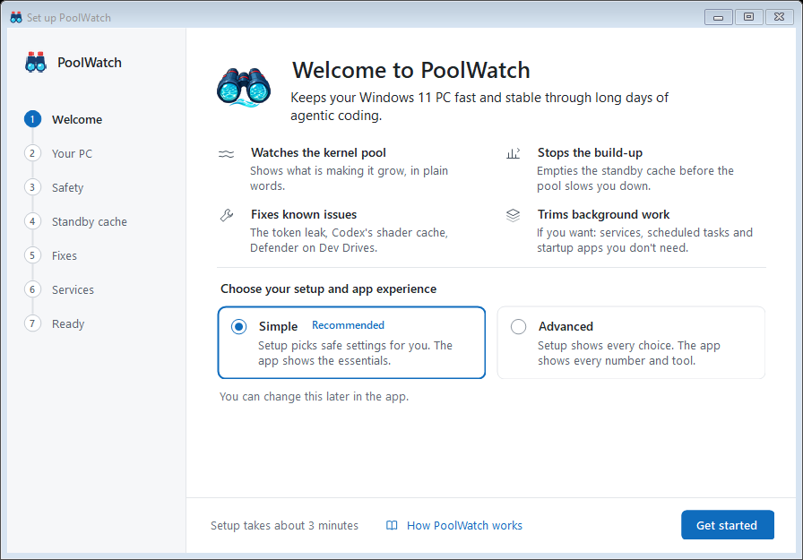 | 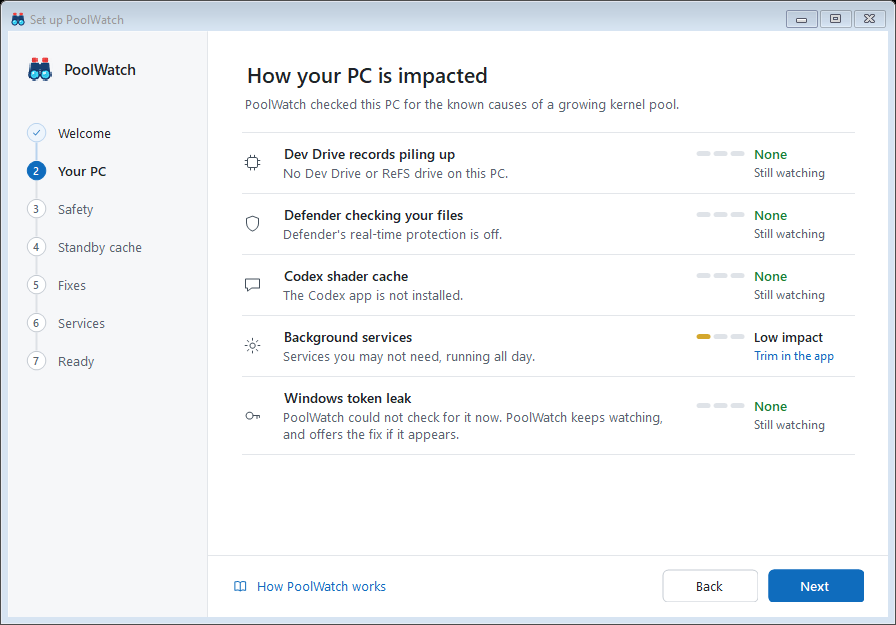 |
| 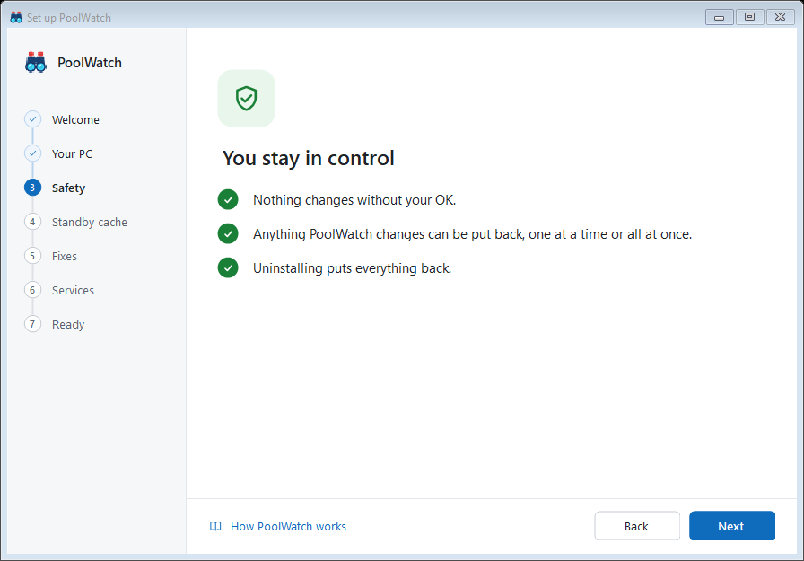 | 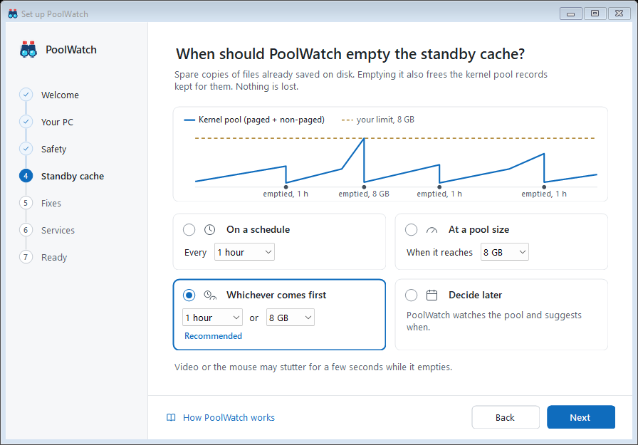 |
| 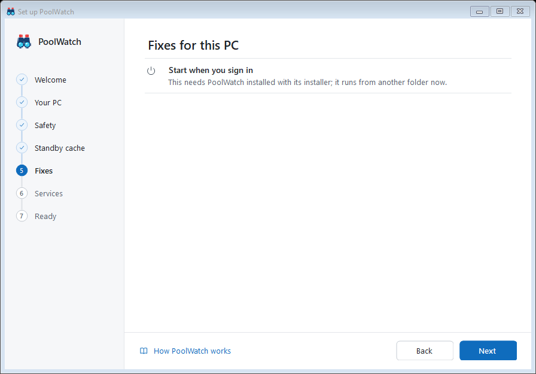 | 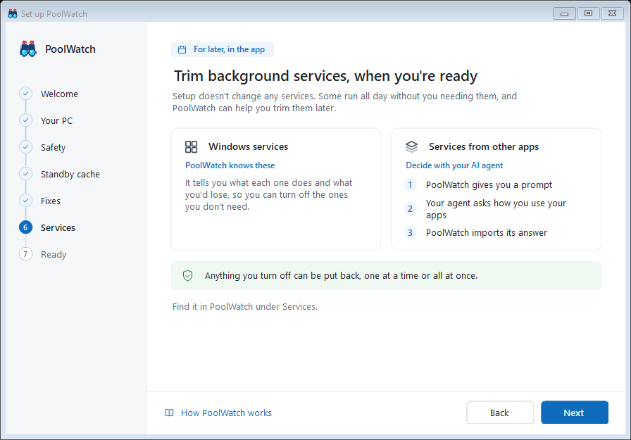 |
| 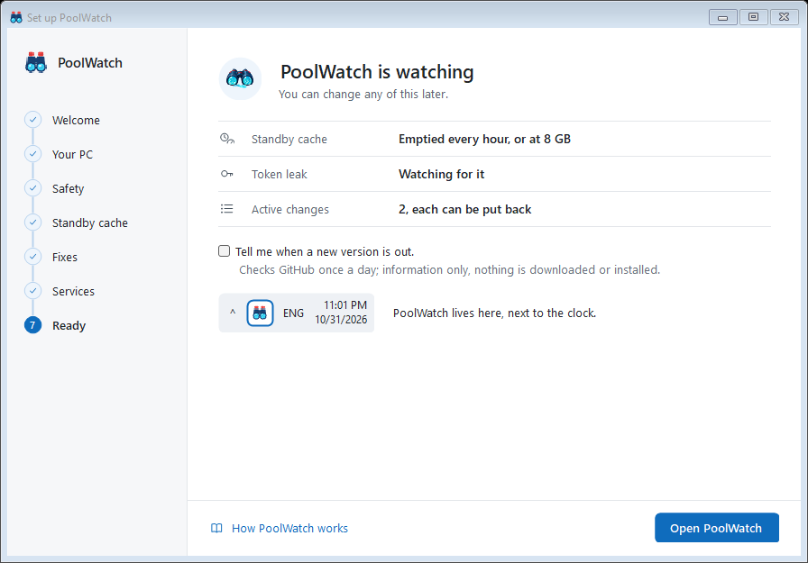 | 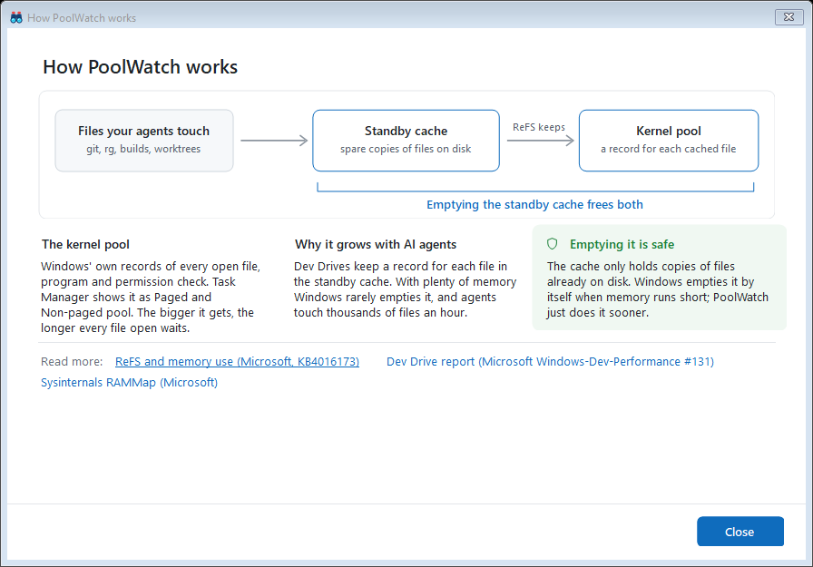 |

1. **Welcome.** What PoolWatch does, and a choice: **Simple** or **Advanced**. It picks the view the app opens in;
   you can switch it later in the app. Both run the same seven steps.
2. **How your PC is impacted.** PoolWatch reads your PC (the Windows version, memory, drives, Microsoft Defender, AI
   tools and background services) and shows, for each known cause of a growing kernel pool, how much it affects this PC:
   **None**, **Low impact**, **Medium impact** or **High impact**, and where setup fixes it ("Fix in step 4"; for
   background services "Trim in the app"; a cause at None says "Still watching"). None means PoolWatch looked and found
   nothing, or, for the token leak, that the leak cannot build up here (a Windows build without it, or the token-leak
   guard on). When it could not look, because it could not read what a cause's level depends on or its check could not
   run or gave no clear answer, the row says so and shows **Not known** in grey, with the meter empty and "Still
   watching", not None. That includes a drive PoolWatch could not read whole (its file system, or whether it is a Dev
   Drive): the row names it ("PoolWatch could not read E:."). The rows are
   listed by level: High impact, Medium impact, Low impact, then Not known and a check still running ("Checking..."),
   then None. The causes: Dev Drive records piling up (a Dev Drive or another ReFS drive: high), Defender scanning your
   Dev Drives, called Defender checking your files on a PC with no Dev Drive (medium when performance mode does not
   cover a Dev Drive; low on a PC with no Dev Drive; none when real-time protection is off or performance mode covers
   every Dev Drive; not known when PoolWatch could not read these settings), the Codex shader cache (low, when the Codex
   app is installed), background services (low, when services you may not need are running) and the Windows token leak.
   On Windows 11 24H2 and later PoolWatch checks this build for the leak by itself (usually about 20 seconds; nothing is
   changed): found, it is high; not found, it is none and the row says "Still watching", because a Windows update can
   bring it back. Its row moves to its level's place when the check ends. When the check could not run (something on the
   PC that already works around the leak stops it too) or gave no clear answer, the row says so and shows Not known.
3. **You stay in control.** Three promises: nothing changes without your OK; anything PoolWatch changes can be put
   back, one at a time or all at once; uninstalling puts each change back, or says why it could not. The few changes
   that cannot fully come back say so in [Active changes](#active-changes), and the uninstaller lists them too, as it
   does a change Windows would not let it put back.
4. **When should PoolWatch empty the standby cache?** **On a schedule** (every 1 hour to begin with), **At a pool
   size** (when the kernel pool reaches 8 GB to begin with), **Whichever comes first** (recommended) or **Decide
   later**, which leaves automatic clearing off: PoolWatch watches the pool and suggests turning it on when it helps.
   The step says that video or the mouse may stutter for a few seconds while the cache is emptied. If you already clear
   the cache with a RAMMap task of your own, the step says so: choosing a rule replaces that task, so the two never both
   run, and your task is saved so you can put it back.
5. **Fixes for this PC.** **Start when you sign in** (on to begin with; a copy not installed with PoolWatch's installer
   gets a note that it needs the installer instead; a sign-in task that is turned off, whose sign-in trigger is turned
   off, or that has no sign-in trigger shows as Off, saying which and where to set it up again; and one that is there
   but does not start PoolWatch for another reason says why, and that finishing with the switch on replaces it);
   **Defender performance mode** for the Dev Drives it does not cover, with **Show me how** (a Windows setting:
   PoolWatch shows you where it is and never changes Defender); **Create a Codex shortcut without its shader cache?**
   (Yes or No; only when the Codex app is installed; PoolWatch does not change the Codex app, the shortcut only starts
   it without that cache); and the **Token-leak guard** when the check found the leak, with its **Why?** open: what
   you will notice and how to undo it (see the
   [README](../README.md#3-it-recognises-known-issues)). While the check still runs, the step says so; if it finds the
   leak after you have moved on, the app offers the guard. When the guard is on already (when you run setup again, for
   example), its row says so and that you turn it off in Active changes, and its **Why?** still says what you will
   notice and how to undo it.
6. **Trim background services, when you're ready.** For later, in the app: setup changes no services. Windows services
   PoolWatch knows, and the services of other apps, which you decide about with your AI agent (see
   [Services](#services)).
7. **PoolWatch is watching.** What setup set (the standby cache, the Codex shortcut, the token leak, Active changes),
   **Tell me when a new version is out** (ticked to begin with; see [Privacy](../README.md#privacy)) and where PoolWatch
   lives: next to the clock. **Open PoolWatch** finishes setup.

Steps 4 and 5 wait until PoolWatch has read the PC ("Looking at your PC... Next is ready in a moment."), at most a
minute; after that, setup goes on with what it knows. Nothing changes until you press **Next** on step 4 (the cache
rule) or step 5 (the fixes you switched on); each change is then listed under [Active changes](#active-changes). On
the Standby cache and Fixes steps, Next is greyed for a second when the step appears, when new results arrive on it,
and after a change that did not work, so you can read what Next will do or why the change failed. Holding Enter does
not repeat Next: press it again to go on.

## Using PoolWatch

### Simple view

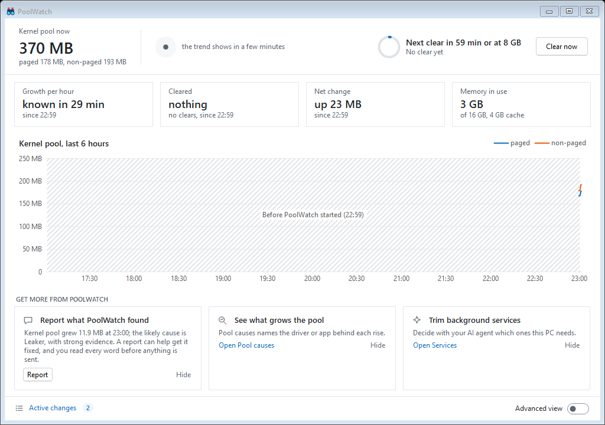

The window opens in the view you chose in setup, and later in the view you used last. The Simple view has:

- **The header**: the kernel pool now ("Kernel pool now 8.4 GB", with its paged and non-paged parts), which way it
  went in the last 10 minutes (an arrow and the amount, or "Steady"), when the next cache clear runs with a ring that
  fills as it comes closer ("Next clear in 37 min or at 8 GB"), and what the last one freed ("Last at 08:59: freed
  914 MB"). Point at the trend for a sentence about it, and at the next clear for the whole line about clearing. A
  drop that follows PoolWatch's own cache clear is that clear's result, never the pool shrinking. A note shows only
  when there is something to watch: a likely cause PoolWatch is sure of ("PoolWatch is keeping an eye on ..."), a
  saturated PC, or where to look while the pool makes the tray icon amber or red. It turns red only for a real risk.
  The header follows the pool alone: while the token-leak guard is not protecting this sign-in, the tray icon's
  tooltip and menu say so.
- **Clear now**, which empties the standby cache at once. It takes a few seconds, and video or the mouse may stutter
  while it runs.
- **Four tiles**, over the graph's 6 hours: **Growth per hour** (how fast the kernel pool grew with PoolWatch's own
  clears added back: "without the clears"), **Cleared** (what the clears freed, and how many), **Net change** ("up 307
  MB") and **Memory in use** now ("41 GB", "of 127 GB, 71 GB cache"). See [Growth and clears](#growth-and-clears).
- **A graph** of the kernel pool over the last 6 hours: the paged and non-paged pool, as Task Manager counts them.
  Each cache clear has a mark: point at it to see what that clear freed. The lines break where PoolWatch was not
  measuring, for example while the PC was asleep.
- **Get more from PoolWatch**: up to three cards. First what PoolWatch found on this PC that one click puts right: the
  token-leak guard once the leak shows, the automatic clear while it is off and clearing is shown to help on this PC,
  and a report about an incident PoolWatch captured. Then cards for parts of the app you may not have found yet
  (Pool causes, trimming background services, and **Mark** for a slow moment). **Hide** keeps a suggestion away for 30
  days, and a feature card for good.
- **The footer**: **Active changes** with how many changes are in effect, the **Advanced view** switch and, while a
  newer version is out, a line that says so.

### Advanced view

Switch on **Advanced view** for the details. The header stays, and the window adds:

- **The graph** with a **1 h / 6 h / 24 h** choice (6 hours to begin with). The graph follows it: its title ("Kernel
  pool, last 24 hours"), its time axis and its clear marks. Before PoolWatch has run that long, the time before it
  started is a labelled band. A clear from before today says so ("Cache clear yesterday at 23:00 (automatic): freed
  1.2 GB"). PoolWatch keeps the window you picked until it exits.
- **Show RAM**, a switch on the graph: RAM in use, the cache (standby) and free, as pale columns behind the pool's
  lines, on a right axis in percent of the PC's RAM. Point at a column for the gigabytes. It is on at first, and
  PoolWatch remembers what you chose.
- **Growth and clears**, a panel beside the graph, for the window picked: the rate, Grew, Cleared, Fell on its own,
  Net change and how long PoolWatch measured.
- **Settings**, in the header on the Pool causes tab.
- Three tabs:
  - **Pool causes**: one list of what grew or was released, what is happening now first. Each row says what grew (the
    pool tag in words, with its driver), how much it grew, what PoolWatch's own cache clears freed of it, its net
    change, how fast it grows, the likely cause, how sure PoolWatch is, its **Impact** and when. Select a row for its
    evidence, with a line saying what PoolWatch already does about it ("Handled: the standby cache is emptied every
    hour, or at 8 GB."). **Export report** is always there (the row's report, else the newest incident's); **Copy
    summary** shows when the row has a summary or evidence to copy, and **Open report folder** once the row's report
    folder exists. A known issue that matches shows as a note here. In a small window the details scroll: Tab reaches
    them at their top, then their words and each button, and the arrow keys scroll them; switching away and back keeps
    your place. What PoolWatch's own cache clear frees is
    that clear's result, not a release: it shows in the clear's own row.
  - **Services**: see [Services](#services).
  - **Tasks and startup apps**: see [Tasks and startup apps](#tasks-and-startup-apps).

| | |
|---|---|
| 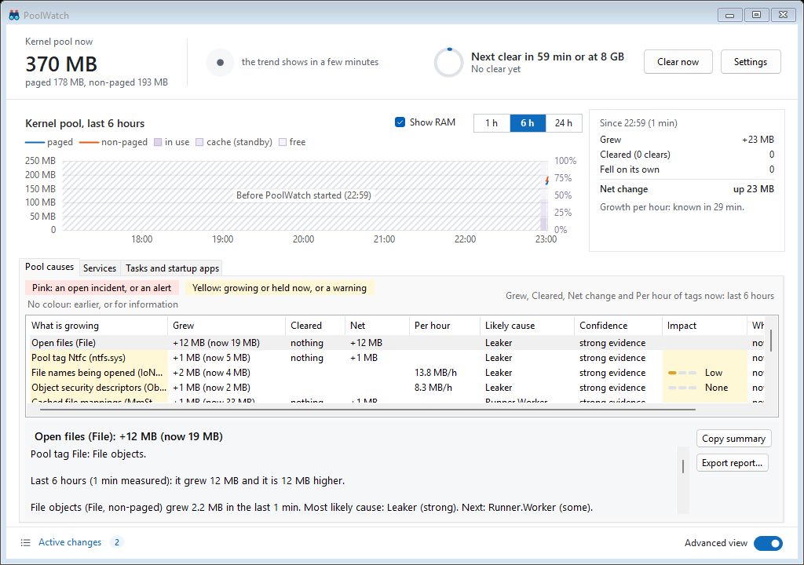 | 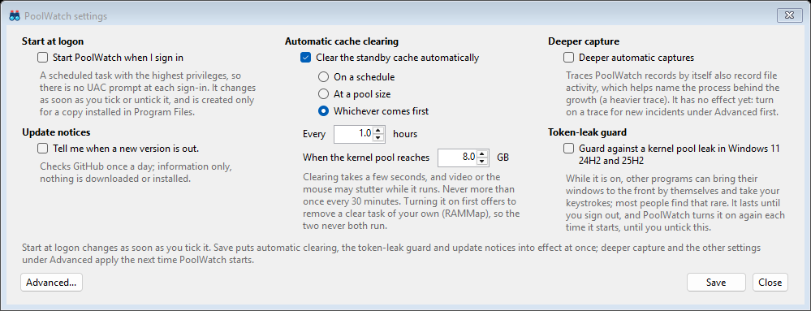 |

**Impact** is the same scale setup uses, from a row's growth per hour: **None** under 10 MB an hour, **Low** under 5 GB
a day, **Medium** under 10 GB a day, and **High** at 10 GB a day or more (1 GB is 1,073,741,824 bytes, as PoolWatch
shows sizes). Where a row's figures follow the window picked (the rows about a tag that has reached 4 MB and is
growing, held or in an open incident now; see [Growth and clears](#growth-and-clears)), that growth is over the window
with PoolWatch's own clears added back, and the cell is empty until PoolWatch has measured 30 minutes. A row with a
growth per hour of its own (a smaller tag's rise over the last 10 minutes, an incident's own growth, the pool charged
to a process) shows its impact at once. A smaller tag that is held, not growing, shows None. A row with no growth per
hour, such as a release, a cache clear, a warning or an alert, leaves the cell empty.

**Settings** is a short form in plain words: starting at sign-in; update notices; automatic cache clearing, by name
(**On a schedule**, **At a pool size** or **Whichever comes first**, recommended) with how often and at what pool size;
deeper automatic captures (traces PoolWatch records by itself also record file activity); and the token-leak guard.
Under automatic clearing it says that clearing takes a few seconds, and video or the mouse may stutter while it runs.
When the Codex app is installed, PoolWatch was installed with its setup and its Codex shortcut is not on your desktop,
Settings offers **Create shortcut**. **Advanced...** opens the settings in a grid, with a short description of
the one selected in the box under it: what it does and its default, its unit, and the limits PoolWatch keeps
it within (a number's range, a text's length, a local drive path), where it has them. Three are set elsewhere:
starting at sign-in (in this form), **Show RAM** (on the graph) and the service profiles (on the Services tab).
Starting at sign-in changes as soon as you tick it; **Save** puts automatic clearing, the token-leak guard and
update notices into effect at once, and the other settings when PoolWatch next starts. The sign-in box is ticked
only while PoolWatch really starts when you sign in. When its task is there but does not start PoolWatch, the box
is not ticked and a line under it says why: the task or its sign-in trigger is turned off (in Task Scheduler, or
kept so when PoolWatch replaced it with its own), it has no sign-in trigger, it runs without the highest privileges
PoolWatch needs, PoolWatch could not read it, or PoolWatch asks you about it at each start. Ticking the box sets
the task up again, turned on. When a tick or an untick cannot change the task, a message says why and the box goes
back to how it was. Unticking the token-leak guard and saving also puts back the Windows setting it changed since
you signed in, also when an earlier run of PoolWatch changed it, when Windows allows it. If Windows does not allow
that just then, the message after Save says so, and Active changes lists the setting with **Put back** to try again;
signing out also puts it back. A setting the guard found already changed, and did not change itself, is left as it is.

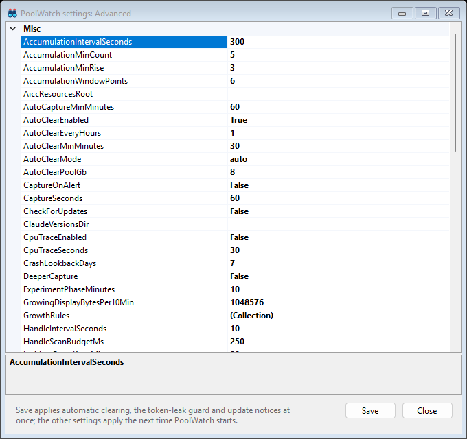

### Growth and clears

The Simple view's tiles and the Advanced view's panel say what the kernel pool did over a window, with PoolWatch's own
cache clears counted apart. The tiles cover the graph's 6 hours; the panel, the window you pick, with Grew, Fell on its
own and how long PoolWatch measured:

- **Grew** or **Fell on its own**: the pool's change over the window with what PoolWatch's clears freed added back, so
  growth before a clear still counts. A rise shows as Grew, a fall as Fell on its own.
- **Cleared (N clears)**: what PoolWatch's own cache clears freed.
- **Net change**: how much the pool rose or fell while PoolWatch was measuring: Grew, less Cleared, less Fell on its
  own. A change while the PC was asleep is not counted (the [technical page](TECHNICAL.md#how-it-decides) gives the
  one exception).
- **The rate** ("Without the clears it would grow 1.26 GB/h" in the panel; "Growth per hour ... without the clears"
  on the tile): that change with the clears added back, for each hour PoolWatch measured. When the pool fell even with
  the clears added back, the panel says "Without the clears it would fall"; with no clear in the window it says "It
  grows" or "It falls". It shows once PoolWatch has measured 30 minutes; until then it says when it will be known
  ("known in 22 min"). The rate times the hours measured, less Cleared, is the net change: 1.26 GB/h over 18 hours is
  22.7 GB, and less the 21.3 GB cleared that is up 1.4 GB.
- **Measured over** (in the panel): time PoolWatch was not measuring, such as while the PC was asleep, does not count
  ("Measured over 18 h of the 24: the rest was not sampled, for example while the PC was asleep.").

PoolWatch keeps these figures, and the graph, in memory, so they start again each time PoolWatch starts. Until it has
run for the whole window, the tiles say since when ("since 08:05"), and once the rate shows, the panel says when
PoolWatch started ("PoolWatch started at 12:20").

In Pool causes, **Grew**, **Cleared**, **Net** and **Per hour** follow the window picked on the graph for the rows
about a tag that has reached 4 MB and is growing, held or in an open incident now; the line above the list says which
window. Other rows show their own figures: a smaller tag its recent rise and its rate over the last 10 minutes, or how
much it holds; an incident what it grew; a process what its pool charge rose by, or, on a row about its handles, how
many handles it gained, or, when it kept running after its parent exited, its I/O operations a second; and a clear or
a release what it freed. Select a row about a tag that has reached 4 MB and its details give the window's figures in a
sentence ("Last 6 hours: it grew 4.9 GB, PoolWatch's own cache clears freed 4.8 GB of it, and it is 103 MB higher.").

Click a column header in any list to sort by it; click it again to reverse the order. The header shows an arrow for
the order.

### Services

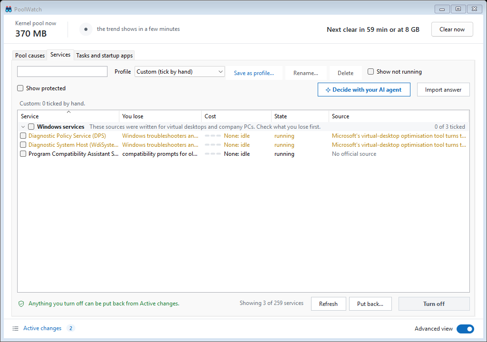

The Services tab lists the background services you may not need. On this tab and the next, the graph steps aside, so
its room goes to the list.

- **The groups.** **Windows services**, which PoolWatch knows, each with where the advice to turn it off comes from:
  "Microsoft's virtual-desktop optimisation tool turns this off", "The CIS security checklist for company PCs turns
  this off", both, or "No official source". These sources were written for virtual desktops and company PCs, so the
  group says to check what you lose first. **From other apps**: no official source, so decide about them with your AI
  agent (below). With **Show protected** ticked, a third group lists the protected services, which PoolWatch never
  changes. A group with no service to show is left out: the test machine in the screenshot shows only Windows
  services.
- **The columns**: Service, You lose, Cost (what it costs the processor now: None, Low, Medium or High), State and
  Source. Rest the pointer on a row for its note and the whole source line. **Find a service** filters the list.
- **Show not running** and **Show protected** are off at first: the list shows what runs now, and leaves out the
  services PoolWatch never changes (security, Windows Update, input and audio, Hyper-V and WSL, and Windows' core). A
  service you ticked always shows. A service PoolWatch turned off is not running, so it waits with the others that are
  off: put it back from Active changes or **Put all back**, or tick **Show not running** to select it.
- **Ticking.** Tick a service, or a group's header to tick its shown services. To tick several at once, select them
  (Shift or Ctrl and click, or Ctrl+A for all) and press Space, or right-click and choose **Tick selected** or
  **Untick selected**.
- **Turn off N services**, on the right, lists the services it changes and asks before it changes anything: those it
  stops and sets to not start, and apart from them those it sets to Manual without stopping them. PoolWatch saves how
  each one was set first, so you can put it back. Services of other apps that PoolWatch does not recognise get a
  second question.
- **Put back...** has three items: **Put back the selected service** (how it was before PoolWatch changed it), **Set
  the selected service to its Windows default** (for a service that was turned off outside PoolWatch; PoolWatch saves
  your setting first) and **Put all back**.

Turning a service off sets it to Disabled and stops it. For some, mostly updaters and helpers, PoolWatch sets Manual
instead and does not stop it: Windows then starts it only when something asks for it. A service that is already
Disabled stays Disabled. So a service counts as off when it is as turning it off leaves it: Disabled and stopped, or
set to Manual if it is one PoolWatch turns off to Manual. A Disabled service that is running, paused, or still
starting or stopping, or whose state Windows could not give, is not off yet, so turning it off tries to stop it. Any
other service set to Manual counts as on, and turning it off sets it to Disabled. Turn off leaves a ticked service
that is off already as it is and records nothing for it: its question lists only the services it changes and says how
many ticked ones are off already, and when all of them are, it says there is nothing to turn off. One exception: a
service PoolWatch turned off that was then changed again outside it, so that Put back refuses it ("it was changed
since"), is turned off and recorded again, so Put back works again.

Windows does not stop a service while a service that depends on it has not stopped. When you turn off both, PoolWatch
stops the one that depends on the other first, and when you put them back, the other comes back first. PoolWatch never
stops or changes a service you did not choose: if a service you did not tick depends on one you turn off and has not
stopped (it is running, or paused, starting or stopping), the one you turn off is set to Disabled but not stopped (it
keeps running, or stays paused if it was paused), and Turn off names each such service and what it is doing ("AcmeSync
depends on it and is paused"). It stops when Windows restarts, or when you turn it off again after the other one has
stopped. A service that is starting, resuming, pausing or stopping is waited for, up to 20 seconds, and so is its stop.
One that has not stopped by then, or whose stop Windows refuses, is still set to Disabled, and Turn off says it is not
stopped and what it was doing: still running, still paused, or still starting, stopping, resuming or pausing (or that
Windows could not say). It stops when Windows restarts, if not before, and until it has stopped it does not count as
off, so turning it off again tries to stop it again.

Put back sets a service back to how it was before PoolWatch changed it, and starts it again if it was running then
(paused or starting counts as running). PoolWatch saves whether it was running from what it saw when it turned the
service off; if it does not know (Windows could not say, PoolWatch could not save what it saw, or PoolWatch
1.0.0-beta.1 turned it off when it did not see it running: that version did not tell paused or starting from
stopped), Put back does not start it. Its row in Active changes then says "not known if it was running", and Put back,
in the app and in the uninstaller, says so unless the service is running by then: start it from Services
(services.msc) if you need it. A service that was Disabled before (one you set to its Windows default, or one that was Disabled but running
when you turned it off) is the exception: it goes back to Disabled and is stopped if it runs, whether it ran before or
not, so its row says only "was Disabled", never whether it was running before, and nor does Put back.
The State column says what each
service is doing: running, stopped, paused, starting or stopping
(never "off" for a service that is paused), "state not known" when Windows could not say, and "could not read" for a
service PoolWatch cannot open (Put back leaves such a service as it is, and says so, until PoolWatch can read it
again). If PoolWatch cannot read the list of services at all, the Services tab says so, and Turn
off, Put back and the profile applied at start change nothing until it can.

#### Decide with your AI agent

What is safe to turn off depends on how you use this PC, so for the services of other apps there is no official list.
**Decide with your AI agent** opens a window with three steps:

1. **Save the prompt**: a file, `poolwatch-services.md`, with what runs on this PC and what to ask you. **Save the
   prompt...** saves it where you pick, nowhere else; **Copy to clipboard** copies it.
2. **Give it to your agent**: Claude Code, Codex or any other: "Read poolwatch-services.md and follow it." Your agent
   asks how you use your apps, then saves its answer, `poolwatch-services-answer.json`.
3. **Import its answer**: **Import answer** on the Services tab.

The window shows every word of the prompt before you save or copy it. What your agent will see: the names and
publishers of the services, scheduled tasks and startup apps on this PC, what each does, and your Windows version.
Never in it: your name, user or PC name, folder paths, or anything from your files (accounts read `<ACCOUNT>`, and a
name longer than 4,096 characters reads `<TOO LONG>`). Like an export's, this redaction is best-effort, so read it.
The prompt is at most 96 KB: on a PC with more than fits, a list stops there and says how many more there are.
Nothing is sent until you give the file to your agent.

**Import answer** reads the answer and shows a review before anything changes: what **Apply** would turn off, what
PoolWatch will not turn off and why (protected services, anything that is not on this PC, Microsoft's own startup apps
and tasks), and what stays as it is. It lists every change and every refusal with its reason; what stays as it is is
listed up to 50 and counted. An item whose name another shares says where it lives (a startup app's place, a task's
folder). Use Tab to reach the list, then the arrow keys, Page Up, Page Down, Home and End. Nothing changes until
**Apply**; services of other apps that PoolWatch does not recognise are asked about again, by name (up to 15, and how
many more). A message then says what was turned off and what was not, and why: each line names up to 15 items and
counts the rest, and it gives up to ten reasons, with the items of any other reasons counted on one more line. If a
service is gone since the review was read, the others are still turned off, and the message says which was not. Every
change is listed under Active changes and can be put back; Put all back and uninstalling put them back too. PoolWatch
refuses an answer in any other form, and never runs or opens anything from it.

#### Profiles

**Profiles** save a choice of services to keep off. Pick one from **Profile** to tick its services:

- **Telemetry only** and **Agentic coding PC** are built in and read-only. Each ticks its services that are not off
  yet. **Agentic coding PC** ticks only services with an official source.
- One of your own ticks all of its services on this PC, also those that are off already (Turn off leaves those as
  they are).
- **Custom (tick by hand)** keeps the ticks you made yourself; they come back when you pick it again.
- Your profiles are kept for the PC, not for your Windows account: another administrator who runs PoolWatch on this PC
  sees the same profiles, and the same one applies at start.
- **Save as profile...** saves the ticked services under a name of your own (or replaces one of yours); you can keep up
  to 50. A profile holds only services PoolWatch recognises; the dialog says how many ticked services it leaves out.
  **Rename...** and **Delete** work on your own profiles. Deleting a profile changes no service. To change which
  services one of yours keeps off, pick it, change the ticks and save it under the same name: the dialog fills in its
  name and whether it applies at start.

Picking a profile only ticks its services: press **Turn off** to turn them off. The line under **Profile** says what
the picked profile keeps off, how many of its services are on now, and whether it applies at start ("Build box: keeps
9 services off; 2 of them are on now. Applied when PoolWatch starts, after 3 minutes."). The tab opens on the profile
that applies at start, with its services ticked; nothing changes until you press **Turn off**.

**Apply a profile when PoolWatch starts.** In the save dialog, tick **Apply this profile when PoolWatch starts, after N
minutes** (1 to 15; 3 to begin with). One profile at a time can do this; **Profile** shows it as "(at start)". Each time
PoolWatch starts, after that many minutes, it turns off any of the profile's services that are on, without asking. That
includes one you turned on yourself outside PoolWatch, in the Windows Services app for example: to keep it on, pick the
profile, untick the service and save the profile again under the same name. A service that is already off is left alone:
Disabled and stopped, or set to Manual if PoolWatch turns it off to Manual (mostly updaters and helpers). Any other
service of the profile found at Manual, for example after a Windows update put it back to its default, is set to
Disabled and stopped if it runs, with no click: that is what the profile is for. (As with Turn off, one that a service
the profile does not list depends on, while that service has not stopped, is set to Disabled but not stopped: it stops
when Windows restarts, and the notice says it was set to Disabled but is not known to have stopped.) A Disabled service stays Disabled, and
a protected service is never touched. When it turned something off, a notice by the clock says so ("Build box turned off
2 services that were on: MapsBroker, SysMain. Click here to see them in Active changes."), and each change is listed
under Active changes: a click on the notice opens it. When it could not turn one off, the notice says so too, and
where the reason is ("Build box could not turn off 1 service: C:\ProgramData\PoolWatch\poolwatch.log says why."). When
another program kept PoolWatch from writing `poolwatch.log` during that run, the notice names the file next to it that
the log went on in, which can be read once PoolWatch has stopped. A reason written before that is in an earlier file
of that run: `poolwatch.log`, a file the log went on in before, or the `.1` of one of them after it rolled over at
2 MB (PoolWatch keeps the newest five such files, from any run). Each such new file's first line names the file it went
on from (once that new file has rolled over, that line is in its `.1`, until a second roll-over replaces it). When you
save such a profile while some of its services are on, PoolWatch offers to turn those off now, with Turn off's own
question. A change you make to the profile while PoolWatch waits to apply it never makes that run turn off more: a
service you add, or another profile you choose, waits for the next start, and a service you take out, or a profile you
delete or no longer apply at start, is left alone. If PoolWatch is still waiting to apply that profile from this start,
the question also says that the services it listed then go off when that wait ends, whatever you answer.

To stop a profile applying at start, pick it in **Profile**, choose **Save as profile...**, untick **Apply this
profile when PoolWatch starts** and press **Save**, or delete the profile. Save keeps the services that are ticked
then, so check the ticks first. Either way, the services it turned off stay off until you put them back.

**Putting back a service that profile lists.** If you put back (in Active changes, or with **Put back...** on the
Services tab) a service that the profile applied at start lists, and the service is on afterwards, PoolWatch first says
that the profile would turn it off again at the next start. If you go ahead, it also takes the service out of the
profile, so the profile no longer turns it off. It takes out only the services its question named: one that was turned
off after you were asked, by the profile at start for example, stays in the profile, and the result says so. **Put all
back** says this once, for all such services, at the end of its question. Putting back that leaves the service off
changes no profile and says nothing about it: for example the row for "Set ... back to its Windows default", whose Put
back sets Disabled again. A service that was put back on is also unticked on the Services tab, so the next **Turn off**
does not turn it off again.

### Tasks and startup apps

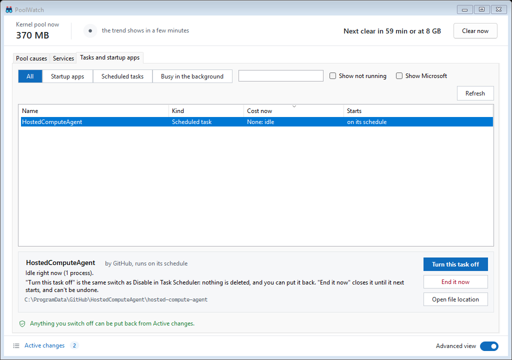

This tab lists startup apps, scheduled tasks and apps busy in the background, ranked by what each costs now.

- **All**, **Startup apps**, **Scheduled tasks** or **Busy in the background** picks what the list shows; **Find**
  filters it. **Show not running** and **Show Microsoft** are off at first: the list shows what is running, and leaves
  out Microsoft's own startup apps, which PoolWatch leaves alone.
- **The columns**: Name, Kind, Cost now and Starts. **Cost now** is the latest sampling window, with the same meter as
  the Services tab (None, Low, Medium, High); for an app busy in the background listed as a row of its own it is its
  30-minute average (a busy app that a startup app or task runs is that one's row, with the latest window). A row reads
  "measuring" until
  PoolWatch has its first sample. An empty list says why.
- **The detail panel**, under the list, says what the selected row runs and when, and what it costs (a program that
  runs through a shared launcher, such as PowerShell, cannot be measured on its own, and the panel says so). The full
  command scrolls in its box and can be selected and copied. **Open file location** shows the program in File
  Explorer.
- **Don't start at sign-in** (a startup app) or **Turn this task off** (a scheduled task) is the same switch as Task
  Manager's Startup apps or Disable in Task Scheduler: nothing is deleted, and you can put it back here ("Start at
  sign-in again", "Turn this task back on") or in Active changes.
- **End it now**, in red, closes the running program until it next starts. It asks first, naming it, and cannot be
  undone: unsaved work in it is lost. It is offered only when every process of the program was matched by its own full
  path, and never for Windows' own, security or service-host processes.
- The switch and End it now wait while the list is read again. **Refresh** reads it again now.

### The tray icon

The binoculars by the clock, with a dot in the state's colour:

- **Green**: all is well, also while something grows for a while (PoolWatch keeps an eye on it).
- **Amber**: an incident is open (a growth PoolWatch is writing a report on), or something keeps memory after the
  program that grew it has stopped, or the token-leak guard is not protecting this sign-in right now (below).
- **Red**: something needs attention: the non-paged pool past PoolWatch's alert level and still rising, or a growth
  whose cause a trace confirmed.
- **Grey binoculars**: starting, no reading yet.

When PoolWatch opens an incident for a growth, a notice by the clock says so ("Kernel pool: Open files (File) is
growing."). It names a likely cause only when the evidence is strong; otherwise it says "Open PoolWatch for details."
A pool that falls gives no notice. When PoolWatch's own check finds the token leak while the guard is off, a notice
says so; a click on it opens the window on the guard.

The token-leak guard shows a small window at the bottom right of the screen only when it needs your click, and only
for its check when PoolWatch starts (or you turn the guard on) or for what you clicked. Windows lets only the program
in front turn its setting on, so when Windows refuses that from the background, one asks you to click **OK** (which
puts PoolWatch in front); when the setting is still not on after the start's check or **Turn on** in a notice, one
says this sign-in is not protected, with **Turn on** and **Not now**, and that one closes when the guard next asks you
for **OK**; after a click on the tray icon none does, as the tray still says it. When the guard turns the setting on
by itself or after your click, nothing is shown.

Later in a sign-in, when something else sets the setting back, the guard opens no window by itself. It turns the
setting on again by itself when Windows lets it, at its regular check (about every 3 minutes by default). While it
cannot, the tray icon's dot is amber (a red dot stays red), and its tooltip and the top of its right-click menu say
**Token-leak guard: not protected right now. Click to turn it on.** A click on the icon, or on that line, turns it on
(if Windows still refuses, the guard's small window asks you to click **OK**); once it is on, the dot and the line go.
What the guard writes then names the program that was in front as PoolWatch saw the setting change, or, when Windows
did not tell PoolWatch of the change, the one in front when its check found it: it names the program that was in
front, which Windows lets change this setting (other programs may be able to as well); this is not proof that it
changed it.

Once the guard finds the setting on, or you turn the guard off, a window of the guard's still asking
for your click closes. `poolwatch.log` in the data folder (or, for a run during which another program kept refusing
its appends, the `poolwatch-<date>-<time>-<process id>-<n>.log` file next to it, whose first line says why), and
`findings.jsonl` in that day's folder under it (`data\<yyyyMMdd>\`), say what the guard did.

Point at the icon for the paged and non-paged pool; double-click it to open the window. Right-click it for the
token-leak guard's line while it is not protected (above), **Open PoolWatch**, **Run setup again...**, **Active
changes...**, a line when a newer version is out, and the tools for
technical users: **Capture now** (a short trace that shows which program allocates the memory), **Since boot
report**, **Open incident folder**, **Export vendor bundle...**, **Copy latest incident summary**, **Mark...** and the
experiments; then **Report an issue...** and **About PoolWatch**. **Exit**, at the bottom, stops PoolWatch until you
start it again (or until you next sign in, if it starts at sign-in). Until setup was finished once, Open PoolWatch and
a double-click open setup instead.

To pin PoolWatch to the taskbar, pin its Start menu entry, or the window of a PoolWatch you started from that entry.
The window of a PoolWatch started any other way (at sign-in, or by opening `PoolWatch.exe` in Explorer) offers no
**Pin to taskbar**: such a pin would start PoolWatch's inner program instead of its launcher. That window belongs to
the same app as the Start menu entry, so pin the entry instead. A copy unpacked from a zip has no Start menu entry: to
pin it, right-click its `PoolWatch.exe` in Explorer and choose **Pin to taskbar** (under **Show more options** on
Windows 11).

## Active changes

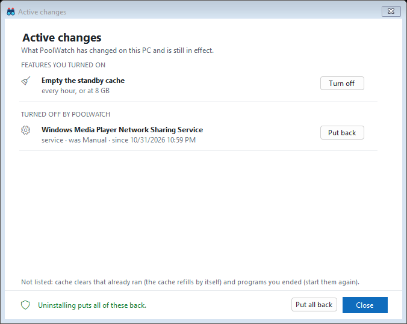

Every change PoolWatch made to your PC that is still in effect is in one window. Open it from the window's footer or
the tray menu. It has up to three groups (a group with nothing in it is left out):

- **Features you turned on**: starting at sign-in ("Start PoolWatch when you sign in"; when its task is there but
  does not start PoolWatch, the row says why, as Settings does), the automatic cache clear
  ("Empty the standby cache", with its rule), the token-leak guard and the Codex shortcut ("Codex shortcut on the
  desktop"). Each has **Turn off**; the shortcut has **Remove**, which deletes it only if it is still as PoolWatch
  made it, and so does a sign-in task that does not start PoolWatch, which Remove deletes.
- **Turned off by PoolWatch**: background services (by the name Windows shows), scheduled tasks, startup apps
  ("<name> at sign-in"), and a RAMMap clear task of yours that PoolWatch replaced. Each has **Put back**. A service one
  of your own profiles turned off says which ("profile Build box", and "at start" when it applied at start). A clear
  task PoolWatch cannot put back by itself, for example one that ran with your saved password, is saved in
  `C:\ProgramData\PoolWatch\removed-tasks` for you to import in Task Scheduler. One whose RAMMap you could change
  without administrator rights, or whose RAMMap is no longer there, is put back only after a warning you accept.
- **Other changes PoolWatch made**: a service you set to its Windows default with **Put back...** on the Services tab
  ("service · set to its Windows default"), and a scheduled task or startup app that was off until you turned it on in
  PoolWatch ("scheduled task · was off", "startup app · was off"). Each has **Put back**, which sets it back to how it
  was before.

**Put all back**, at the bottom, asks once and then does them all. Some rows carry a note. The token-leak guard's row
says that Turn off also puts back the Windows setting it changed when Windows allows it, and that one it found already
changed stays until you sign out; if Windows did not allow that when the guard was turned off, that setting has a row of
its own under the other changes, whose **Put back** tries again. A row PoolWatch cannot put back says so, and a row the
uninstaller would leave says "Uninstalling does not put this back", with why. A service that the profile applied at
start lists, and that putting back turns on again, carries a warning: putting it back also takes it out of that profile,
and **Put all back** says so once for all of them (see [Profiles](#profiles)). When anything is listed, the footer says
"Uninstalling puts each of these back, or says why it could not.", or, when a row says the uninstaller leaves it,
"Uninstalling puts each of these back, except where marked, or says why it could not." Not listed: cache clears that
already ran (the cache refills by itself) and programs you ended (start them again).

## Report an issue

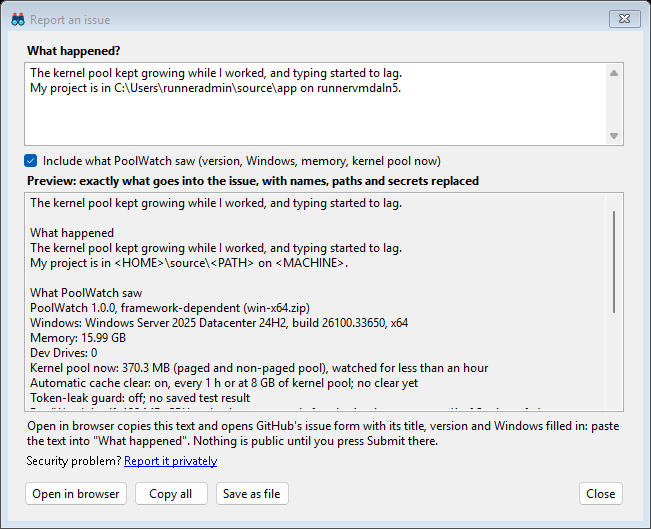

From the tray menu, from About, or from a card after PoolWatch recorded an incident:

1. Write what happened.
2. Read the preview: it is exactly the text that goes into the issue, with your user name, PC name, paths, e-mail
   and network addresses, and anything that looks like a password or key replaced.
3. Press **Open in browser**. PoolWatch copies the text and opens GitHub's issue form with only the title, PoolWatch's
   version and Windows filled in. Paste the text into "What happened", tick the **Redaction** box (the preview already
   took your names out), and press **Submit** when you are ready (you need a free GitHub account). Nothing is public
   until you do.

What goes in: PoolWatch's version and how it was installed; the Windows version, build and processor type; the amount
of memory and number of Dev Drives; the kernel pool now and over the last hour; the automatic clear and its last
result; the token-leak guard; PoolWatch's own CPU and memory use; the 8 largest pool tags; and, for an incident, its
summary and likely causes. Never: command lines, other programs' paths, window titles, the names of AI assistant
sessions (the issue may say a program ran under Claude Code or Codex), project or account names, the services list or
your environment variables.

**Copy all** and **Save as file** keep the text without opening anything. A security problem goes to the private
link in the same window, never to a public issue (see [SECURITY.md](../SECURITY.md)).

Asking an AI assistant to look at PoolWatch's data? Point it at `C:\ProgramData\PoolWatch\AGENTS.md` first: it explains
every file, and asks the assistant to change nothing and post nothing.

## The zips (install by hand)

Each release also has two zips, if you would rather install by hand:

| File | Needs |
|---|---|
| `PoolWatch-v1.0.0-win-x64-selfcontained.zip` | nothing else (.NET is inside) |
| `PoolWatch-v1.0.0-win-x64.zip` | the [.NET 10 Desktop Runtime](https://dotnet.microsoft.com/download/dotnet/10.0) (x64), installed for all users |

Start PoolWatch with `PoolWatch.exe`. That program is PoolWatch's launcher: it asks for administrator rights and starts
PoolWatch itself, `app\PoolWatch.exe` in the `app` folder beside it, with an environment it builds from Windows' own
values. Each zip has the launcher a second time, as `PoolWatch-selfcontained.exe` (see the last point below). PoolWatch
runs only from inside Program Files, from a folder that only administrators can change, so unpack the **whole** zip
into `C:\Program Files\PoolWatch` (the launcher, the `app` folder and the files beside them). Unpack it straight there:
a folder unpacked somewhere else, such as Downloads, and then moved keeps the permissions it had, and PoolWatch refuses
to run from it. Starting at sign-in works there too; the Codex shortcut (see
[Known issues](../README.md#3-it-recognises-known-issues)) needs the setup.

- **The .NET runtime, for the framework-dependent zip**: install it with Microsoft's installer, which installs it for
  all users. A runtime unpacked into your own folders (found through `DOTNET_ROOT`) is not used: PoolWatch starts as
  administrator with an environment its launcher builds from Windows' own values, and a runtime in a folder you can
  change could be swapped for other code. Without an all-users runtime that zip's PoolWatch does not start; the
  self-contained zip needs none.
- **Updating by unpacking a newer zip over an older copy** works as it is, from either zip to either. Before 1.0,
  PoolWatch itself was `PoolWatch.exe` in the framework-dependent zip and `PoolWatch-selfcontained.exe` in the
  self-contained one. Each zip now has the launcher under both names, so it replaces both, and a logon task or a
  shortcut that the older copy made starts the launcher once you have unpacked the new zip. PoolWatch also takes a
  program under either name for its launcher only when it is of the same version as `app\PoolWatch.exe`; if unpacking
  left an older program there (a file that was in use, say), PoolWatch says so and asks about a logon task that starts
  it. An older copy's `amd64` folder beside the launcher stays: nothing uses it any more, and you can delete it.

## Uninstall

Open **Settings** > **Apps** > **Installed apps**, click **...** next to **PoolWatch**, and choose **Uninstall** (or
right-click PoolWatch in the Start menu and choose **Uninstall**). The uninstaller:

1. lists the changes PoolWatch made that are still in effect, and any it cannot put back (with why), and asks: **Put
   them back (recommended)**, the default, or **Keep my changes**. Putting them back turns back on the services,
   scheduled tasks and startup apps PoolWatch turned off, puts back a clear task it replaced and its other changes, and
   turns off its own features (turning off the token-leak guard also puts back the Windows setting it changed since you
   signed in, when Windows allows it; when it does not, the uninstaller says so and the setting stays until you sign out);
   what it cannot put back stays as it is. When the guard found its Windows setting already changed and did
   not change it itself, it says that the setting stays until you sign out;
2. always removes the sign-in task, and the Codex shortcut unless you changed it;
3. writes what it put back, and anything it could not, to `C:\ProgramData\PoolWatch\uninstall-summary.txt` (a service
   whose start type it put back but that it did not start again is "Partly put back", with why). When PoolWatch had to
   keep its data in a folder of its own next to that one (its name starts with `PoolWatch.safe-`), the summary is in
   that folder instead, the uninstaller says so, and neither folder is deleted. PoolWatch's record of that folder, the
   registry key `HKLM\SOFTWARE\PoolWatch`, stays too, so a PoolWatch you install again finds the folder (it moves the
   folder back to `C:\ProgramData\PoolWatch` when it can, and deletes the record once you have deleted the folder); if
   you will not install PoolWatch again, you can delete that key yourself;
4. if everything was put back, says what it put back, first anything it put back only in part with what was not done,
   and asks whether to also delete PoolWatch's reports, logs and settings (`C:\ProgramData\PoolWatch`); the default is
   No. It names the first ten of each list and counts the rest; when it counts some, it says that
   `uninstall-summary.txt` names them all (with what was not done, when it put one back only in part), and answering
   No keeps it. If something could not be put back, it says
   what and why, and what it put back only in part.
   If you kept the changes, or something could not be put back, the folder is kept without asking, so a later
   PoolWatch can still put back what is recorded there. When the folder is deleted, what another program still has in
   use (a PoolWatch still running keeps the folder itself open) is left: the uninstaller then says what is left, in its
   log and, when you started it by hand, in a box, for you to delete once no program has it in use. It does not leave
   that to the next restart, as a PoolWatch you install again before then keeps its data in the same folder.

The uninstaller removes no file when PoolWatch's cleanup failed (it may have put back only part of the changes): started
by hand, it says why and what to do, and offers **Retry**; a silent uninstall ends with nothing removed. A token-leak
test helper left running is ended for you. Once the cleanup is done, if part of PoolWatch still runs, or may (a file of
it is still in use and its processes could not be listed), the cleanup runs once more, to stop a PoolWatch started
meanwhile and undo what it changed (when you keep the changes, only by removing its logon task and desktop shortcut);
the summary keeps what both runs did. Files still in use (another program runs one or has
one open), and a folder still in use (a command window's current folder, say), do not stop the uninstall: everything
else is removed at once, and Windows deletes them the next time it restarts, with the folder. Started by hand, the
uninstaller then names the first ten of those files, each with the program that has it open, its process ID and its
account, and says how many more there are. If Windows could not be given some of what is left, or a file an earlier
update of PoolWatch may have Windows move into the folder at that restart would stay after it, the uninstaller says so:
delete what is left after the restart. Started from Apps and Features, or with `/LOG`, it writes a log that names each
of them, in the TEMP folder of the account it runs as (that of the administrator whose password you typed, when Windows
asked for one; the notice says where, when it names only the first ten); started without `/LOG` it writes none. It never
restarts Windows itself; a silent uninstall ends with exit code 0 then too (Inno Setup's uninstaller lets PoolWatch give
no other code, and that code is its first copy's, which ends before its second copy, `_unins.tmp` in a folder of its own
in TEMP, removes what is left). To tell from a script, start it with `/LOG=<file>` and wait for that second copy to end
too: the log then says whether the uninstall finishes at the next restart (it does not when Windows could not be given
some of what is left, which then stays, to delete by hand, and it may not when the uninstaller could not make ready the
place of a file an earlier update may have Windows move into the install folder at that restart), and, after the time
stamp the log puts before each message, each file or folder left for the restart is named in a message that starts
"Windows deletes it at its next restart: ", each thing Windows could not be given in one that starts "Windows could not
be given ", and each file that may stay after it in one that starts "May stay after the next restart: ". If Windows says
the uninstaller could not be started, or the uninstaller says it could not open its record, another program has the
uninstaller's own files open: run PoolWatch's setup again, which writes a new uninstaller, then uninstall.

The setup of a new version waits in the same way before it replaces any file, and gives a file another program has
open only for a moment (a virus scanner, say) a few seconds more. To replace them, it first sets every old file aside
and only then writes the new ones; it deletes the old ones once every new one is in place, and puts them all back if it
does not get that far (you cancel, or a step fails), with the Start menu entry and the Apps and Features entry, so the
version you had stays. An old file another program has open then goes back too: as a copy, or under a second name of
the same file. If another program has one of the new files open, or runs it, so that it cannot be removed until
Windows restarts, Windows removes it then, and every old file goes back only at that restart, its launcher last; until
then its launcher is not there, so neither its Start menu entry nor its sign-in task starts PoolWatch, unless that
other program holds the new version's launcher and its program, which then start the new version without its other
files until the restart. The setup says which, and names the files in use with the program that has each open (in a
box when you run it by hand: the first ten, and how many more; in its log: every one). So until the restart PoolWatch
never runs from old and new files mixed. If Windows does not take that work for the restart, the setup says so: an
old file stays under the name it was set aside under, and a new file stays after the restart too (under its own name
when another program kept the setup from renaming it; the launcher of the version you had then stays set aside, so it
starts nothing from the mix, and when that new file is PoolWatch's launcher, every file of the version you had stays
set aside). PoolWatch may then not start after the restart until you run the setup again, and run it again before you
uninstall. When one of PoolWatch's files is still in use after that wait (another program runs
it or has it open), or comes into use while the setup sets the files aside, or an earlier setup or uninstall of
PoolWatch is waiting for the next restart, the setup puts the new version beside the old one, and Windows puts it in
place the next time it restarts. Its last page says what starts PoolWatch until then: the version you had, unless an
earlier setup that did not finish, an earlier uninstall (PoolWatch is then not installed until the restart) or a file
another program holds leaves less in place. The setup says so and why on its last page, which
lists every file in use, with the program that has it open, its process ID and its account; it also always writes a log
that names them, in the TEMP folder of the account it runs as. It does not offer to start PoolWatch, and never restarts Windows itself, also when
you run it again before that restart (it then finishes at that restart too); a silent setup ends with exit code 3010,
Windows' code for "done; a restart completes it". Another program that has the uninstaller's own files open when the
setup looks does not stop it: the setup then writes its uninstaller in a folder of its own, which Apps and Features uses
from then on (one that opens them later, while the setup runs, can make it fail; it then puts everything back as
above). If Windows does not take the setup's work for the restart, the setup takes the new files back, ends with exit
code 1603 and says to run it again after the restart; its last page names any file it could not take back, which the
restart then puts among the files of the version you had, and any file of the version you had that it set aside now so
that the restart does not replace it. The setup then sets PoolWatch's launcher aside, at once or, where another program
holds it, at the restart, so after the restart PoolWatch does not start from that mix until you run the setup again
(unless Windows does not take that either, which the page then says). Uninstalling before that restart, when the
update is the one that moved PoolWatch into its `app` folder (from 1.0.0-beta.1), or after a setup that left old files
to go back at the restart, removes nothing, unless Windows did not take all of that setup's work (the setup then says
to run it again before you uninstall: do so): this version's uninstaller says to restart Windows first.
1.0.0-beta.1's own uninstaller says its record (`unins000.dat`) does not exist, as the setup set it aside until the
restart; or, when another program kept the setup from that, it says its messages file (`unins000.msg`) is missing, as
the setup set that aside instead; or, when another program kept the setup from that too, Apps and Features finds no
uninstaller to start (`unins000.exe`), as the setup set that aside: if Windows then offers to remove PoolWatch from its
list of apps, answer No, as the setup's box and log say. When the setup could set none of them aside, its box and its
log say not to uninstall before the restart: do as they say, as 1.0.0-beta.1's uninstaller would then remove
PoolWatch's Apps and Features entry and keep its changes and its sign-in task, and the files Windows puts back at the
restart would have no entry.

Your service profiles are part of the settings in that folder, and the uninstaller does not change them. If you keep
the folder and install PoolWatch again, a profile you chose to apply at start applies again.

A pre-release build of PoolWatch kept its data in a folder of your own, `%LOCALAPPDATA%\PoolWatch`. PoolWatch, its
setup and its uninstaller never read, move or delete that folder: if you have one, it is left as it is, and you may
delete it yourself.

From a command line, run the uninstaller that Apps and Features starts (the program in `UninstallString` of
PoolWatch's entry under `HKLM\SOFTWARE\Microsoft\Windows\CurrentVersion\Uninstall`: usually
`C:\Program Files\PoolWatch\unins000.exe`, or one below `C:\Program Files\PoolWatch\uninstall\` after a setup that
could not write it there). With `/VERYSILENT`
it puts back everything it can without asking and keeps the data folder; it shows nothing. Add `/LOG` for a log in the
TEMP folder of the account it runs as (or `/LOG="<file>"` for one where you say), as Apps and Features does: without
it the uninstaller writes none. Add `/KEEPCHANGES` to keep
the changes (the sign-in task and the shortcut still go), or `/DELETEDATA` to also delete the data folder, once every
change was put back. `/DELETEDATA` never asks either: started by hand, it puts back what it can and then says what it
put back, or what it could not. Since it deletes `uninstall-summary.txt` with the folder, it names every change it put
back only in part, with what was not done, ten to a box; of the changes it put back whole it names the first ten and
counts the rest. What of the data folder another program still has in use is left, and the uninstaller says what (in
its log, and in a box when started by hand).

Installed from a zip: use **Put all back** in Active changes, exit PoolWatch (tray menu > **Exit**), then delete
`C:\Program Files\PoolWatch` and `C:\ProgramData\PoolWatch`.

## About PoolWatch

The About window (tray menu, **About PoolWatch**) lists the credits, with links; the README's
[Credits](../README.md#credits) has the same list.

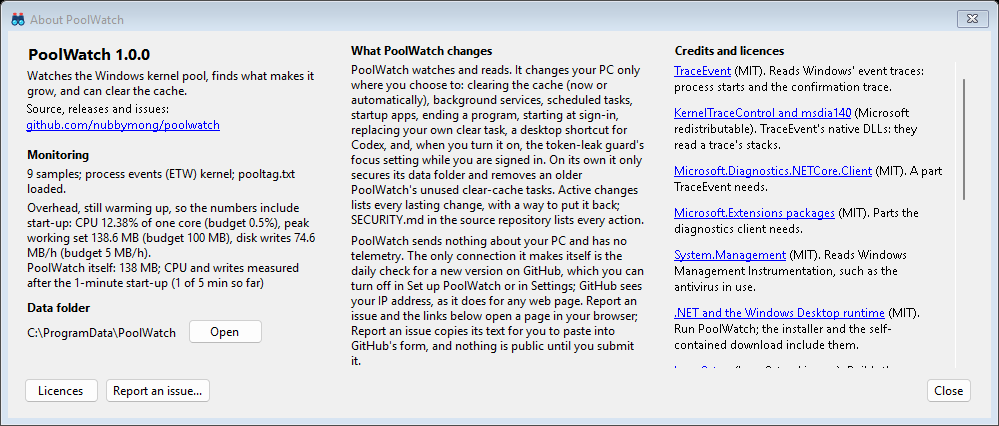
