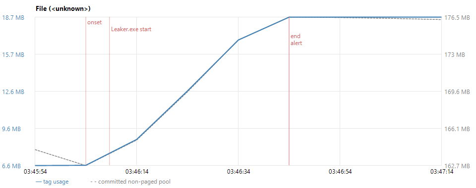

# `File` (&lt;unknown> File objects) grew 12.1 MB in 39 s; top suspect Leaker.exe PID 7716, started 03:46:08 (strongly correlated)

- Incident `20261026-034624-File-656c6946` (Growth), opened 2026-10-26 03:46:24 +00:00, closed 2026-10-26 03:47:14 +00:00
- Tag `File` (raw 0x656c6946; tags are case-sensitive): owner **&lt;unknown>**, File objects (source: pooltag.txt)
- Growth: 6.6 MB -> 18.7 MB (+12.1 MB) from 03:46:04 to 03:46:44; now 18.7 MB
- Alert 03:46:44: grew > 3 MB in 1 min (+12.1 MB, onset 03:45:54)
- **Retained**: File still holds 12.1 MB of its 12.1 MB rise 30 s after Leaker.exe (PID 7716) went quiet.
- Sizes are the tag's own usage from SystemPoolTagInformation; Task Manager's committed pool figures run higher (fragmentation, lazy release).



## Suspects

Ranked by every signal: direct charge (handles of the matching object type, quota pool), activity correlation (Spearman of the tag's growth against the process's I/O rate, plus its share of all I/O), lifecycle (start before onset, exit when growth stopped, orphaned while busy). Correlation is not causation: only a confirmation trace proves an allocation.

| # | Process | PID | Confidence | Score | Evidence |
|---|---|---|---|---|---|
| 1 | Leaker.exe | 7716 | strongly correlated | 7.61 | direct charge: File handles 0 -> 30,026 (+30,026, 100% of the File-handle growth, ~12.1 MB of the File growth); quota pool usage +388 KB (73% of all quota growth); activity correlation: 24,696 I/O ops in the episode (51% of all), Spearman vs total ops 0.79, lag 1 0.32; lifecycle: started 03:46:08, 4 s after growth onset |
| 2 | pwsh.exe | 7904 | strongly correlated | 3.37 | activity correlation: 13,886 I/O ops in the episode (29% of all), Spearman vs other ops 0.09, lag 3 0.89; lifecycle: started 03:45:53, 10 s before growth onset |
| 3 | PoolWatch.exe | 8136 | correlated | 1.47 | direct charge: File handles 65 -> 95 (+30, 0% of the File-handle growth, ~12 KB of the File growth); activity: 5,836 I/O ops in the episode (12% of all), Spearman vs other ops 0.46, lag 1 0.04; lifecycle: started 03:45:53, 10 s before growth onset |
| 4 | csrss.exe (orphan) | 6840 | weak signal | 0.41 | activity: 63 I/O ops in the episode (0% of all), Spearman vs total ops -0.05, lag 3 0.82; lifecycle: orphaned at 03:45:54 (parent PID 6828 gone), running 6 min |
| 5 | Runner.Worker.exe | 2204 | weak signal | 0.41 | activity: 51 I/O ops in the episode (0% of all), Spearman vs total ops 0.34, lag 3 0.82 |
| 6 | svchost.exe (EventLog) | 2244 | weak signal | 0.39 | activity: 42 I/O ops in the episode (0% of all), Spearman vs total ops 0.78, lag 1 0.44 |
| 7 | svchost.exe (Schedule) | 2444 | weak signal | 0.38 | activity: 39 I/O ops in the episode (0% of all), Spearman vs total ops 0.48, lag 1 0.76 |
| 8 | sihost.exe | 3888 | weak signal | 0.38 | direct charge: File handles 7 -> 9 (+2, 0% of the File-handle growth, ~845 B of the File growth); activity: 25 I/O ops in the episode (0% of all), Spearman vs total ops 0.48, lag 1 0.76 |
| 9 | OpenConsole.exe | 3684 | weak signal | 0.36 | activity: 89 I/O ops in the episode (0% of all), Spearman vs read ops -0.08, lag 3 0.71 |
| 10 | svchost.exe (Winmgmt) | 1652 | weak signal | 0.35 | activity: 1 I/O ops in the episode (0% of all), Spearman vs read ops -0.08, lag 3 0.71 |

## Process details

### 1. Leaker.exe (PID 7716)

- Executable: `Leaker.exe`
- Command line: `"D:\a\poolwatch\poolwatch\publish\leaker\Leaker.exe" leak-handles --dir D:\a\_temp\leaker-ui --count 30000 --ramp 30 --hold 40`
- User: runnervmdaln5\runneradmin
- Parent chain: wininit.exe › services.exe › svchost.exe (Schedule) › hosted-compute-agent › Runner.Listener.exe › Runner.Worker.exe › pwsh.exe › Leaker.exe
- Started: 2026-10-26 03:46:08 +00:00; still running

### 2. pwsh.exe (PID 7904)

- Executable: `C:\Program Files\PowerShell\7\pwsh.exe`
- File version: 7.6.7.500; company: Microsoft Corporation; product: PowerShell
- Signature: valid embedded signature, signer Microsoft Corporation
- Command line: `"C:\Program Files\PowerShell\7\pwsh.EXE" -command ". 'D:\a\_temp\fb501258-4e4e-4cda-8855-c7040017bd07.ps1'"`
- User: runnervmdaln5\runneradmin
- Parent chain: wininit.exe › services.exe › svchost.exe (Schedule) › hosted-compute-agent › Runner.Listener.exe › Runner.Worker.exe › pwsh.exe
- Started: 2026-10-26 03:45:53 +00:00; still running

### 3. PoolWatch.exe (PID 8136)

- Executable: `D:\a\poolwatch\poolwatch\publish\fd\PoolWatch.exe`
- File version: 1.0.0.0; company: PoolWatch; product: PoolWatch
- Signature: no embedded signature (may be catalog-signed)
- Command line: `"D:\a\poolwatch\poolwatch\publish\fd\PoolWatch.exe" --ui-smoke 80 --config D:\a\poolwatch\poolwatch\ci\m2-config.json --interval 10 --out D:\a\_temp/ui`
- User: runnervmdaln5\runneradmin
- Parent chain: wininit.exe › services.exe › svchost.exe (Schedule) › hosted-compute-agent › Runner.Listener.exe › Runner.Worker.exe › pwsh.exe › PoolWatch.exe
- Started: 2026-10-26 03:45:53 +00:00; still running

### 4. csrss.exe (PID 6840)

- Executable: `C:\Windows\System32\csrss.exe`
- File version: 10.0.26100.1 (WinBuild.160101.0800); company: Microsoft Corporation; product: Microsoft® Windows® Operating System
- Signature: valid embedded signature, signer Microsoft Windows Publisher
- Command line: `%SystemRoot%\system32\csrss.exe ObjectDirectory=\Windows SharedSection=1024,20480,768 Windows=On SubSystemType=Windows ServerDll=basesrv,1 ServerDll=winsrv:UserServerDllInitialization,3 ServerDll=sxssrv,4 ProfileControl=Off MaxRequestThreads=16`
- User: NT AUTHORITY\SYSTEM
- Parent chain: csrss.exe
- Started: 2026-10-26 03:41:05 +00:00; still running; orphaned 2026-10-26 03:45:54 +00:00

### 5. Runner.Worker.exe (PID 2204)

- Executable: `C:\actions-runner\cached\2.338.0\bin\Runner.Worker.exe`
- File version: 2.338.0.0; company: Runner.Worker; product: Runner.Worker
- Signature: no embedded signature (may be catalog-signed)
- Command line: `"C:\actions-runner\cached\2.338.0\bin\Runner.Worker.exe" spawnclient 1720 1732`
- User: runnervmdaln5\runneradmin
- Parent chain: wininit.exe › services.exe › svchost.exe (Schedule) › hosted-compute-agent › Runner.Listener.exe › Runner.Worker.exe
- Started: 2026-10-26 03:45:13 +00:00; still running

## Events in the window

- 03:45:54 Exit schtasks.exe (PID 8364) code 1
- 03:45:54 Orphaned conhost.exe (PID 7344): parent schtasks.exe (8364) exited
- 03:45:54 Exit conhost.exe (PID 7344) code 0
- 03:45:58 Exit fltMC.exe (PID 5760) code 0
- 03:45:58 Orphaned conhost.exe (PID 9056): parent fltMC.exe (5760) exited
- 03:45:58 Exit conhost.exe (PID 9056) code 0
- 03:46:08 Exit taskhostw.exe (PID 4404) code 0
- 03:46:08 Start Leaker.exe (PID 7716)
- 03:46:11 Exit wsl.exe (PID 5924) code -1
- 03:46:11 Exit wsl.exe (PID 6828) code -1
- 03:46:30 Exit svchost.exe (PID 6484) code 0
- 03:46:41 Exit wsl.exe (PID 7836) code -1
- 03:46:41 Exit wsl.exe (PID 3100) code -1
- 03:46:58 Exit WmiPrvSE.exe (PID 5128) code 0
- 03:47:11 Exit wsl.exe (PID 1552) code -1
- 03:47:11 Exit wsl.exe (PID 1480) code -1
- 03:47:11 Exit smartscreen.exe (PID 2860) code 0

(11 other events in events.csv)

## System

- Machine: runnervmdaln5; Windows Server 2025 Datacenter 24H2 (build 26100.33650); 2 logical CPUs; 7.99 GB RAM; booted 2026-10-26 03:40:10 +00:00
- Volume C:\ NTFS Fixed "Windows"
- Volume D:\ NTFS Fixed "Temp"
- Antivirus: none registered
- File-system filter drivers (`fltmc filters`):

```
Filter Name                     Num Instances    Altitude    Frame
------------------------------  -------------  ------------  -----
bindflt                                 1       409800         0
WdFilter                                4       328010         0
storqosflt                              0       244000         0
wcifs                                   0       189900         0
PrjFlt                                  0       189800         0
CldFlt                                  0       180451         0
bfs                                     6       150000         0
FileCrypt                               0       141100         0
luafv                                   1       135000         0
UnionFS                                 0       130850         0
npsvctrig                               1        46000         0
Wof                                     1        40700         0
```

## Draft bug report for Leaker.exe

**Summary**

While Leaker.exe runs, kernel pool tag `File` (&lt;unknown> File objects) grows by 12.1 MB in 39 s and is not released after the activity stops.

**Environment**

- Windows Server 2025 Datacenter 24H2, build 26100.33650, 2 logical CPUs, 7.99 GB RAM
- C:\ NTFS
- D:\ NTFS
- Antivirus: none registered; filter drivers: see the System section
- Process: `Leaker.exe`

**Steps to reproduce** (template: fill in)

1. Start Leaker.exe as `"D:\a\poolwatch\poolwatch\publish\leaker\Leaker.exe" leak-handles --dir D:\a\_temp\leaker-ui --count 30000 --ramp 30 --hold 40`.
2. <what it was doing: the workload, files or folders involved>.
3. Watch kernel pool tag `File` (poolmon, or the attached timeline.csv).

**Expected**: pool usage returns to its baseline when the work finishes.

**Actual**: `File` (&lt;unknown> File objects) grew 12.1 MB in 39 s; top suspect Leaker.exe PID 7716, started 03:46:08 (strongly correlated).

**Attached evidence**: report.md, report.json, timeline.csv (tag and pool totals), processes.csv (suspects' counters), events.csv (process lifecycle), timeline.png.
